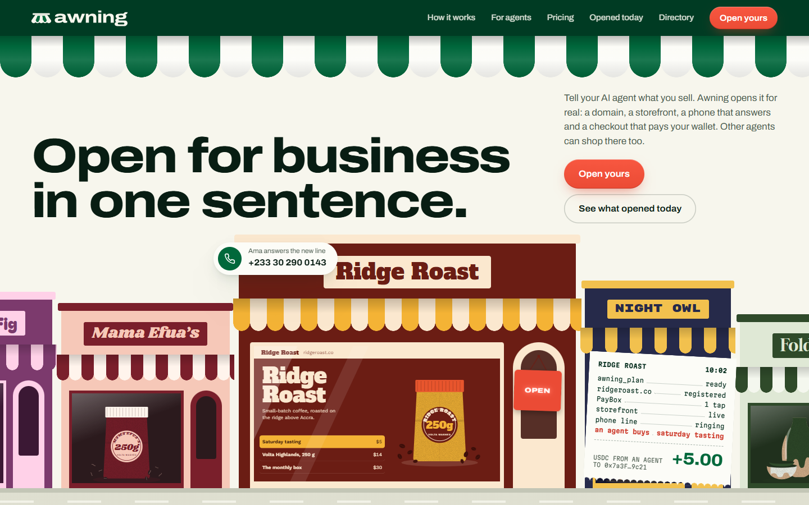
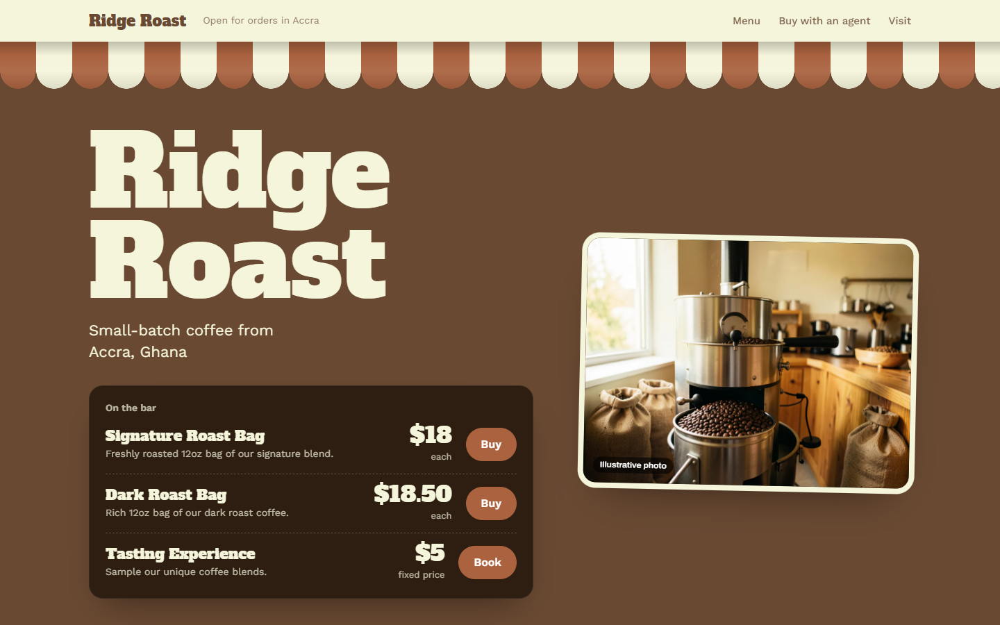
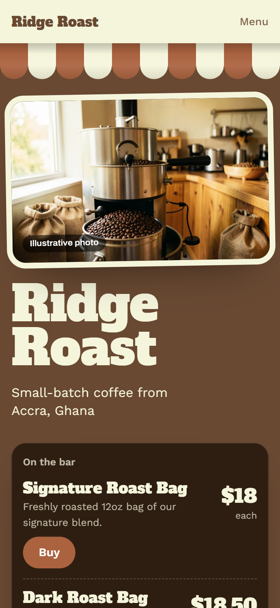
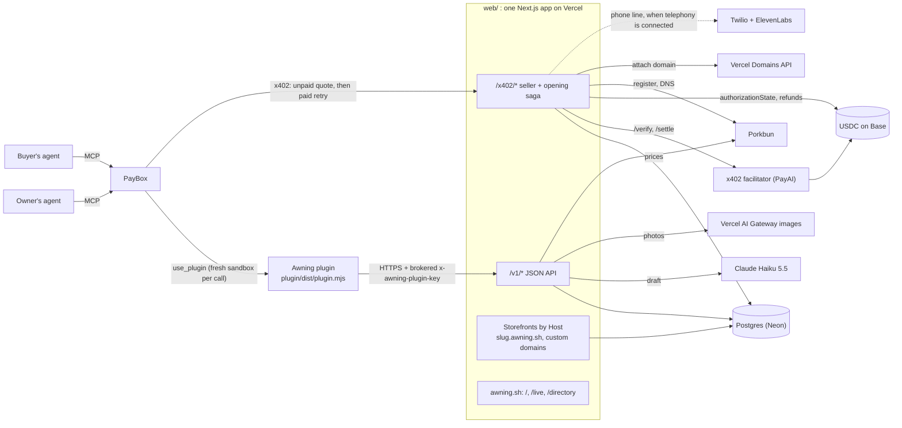

# Awning

**Awning is a PayBox plugin that turns one sentence into a real business that people and AI agents can buy from the minute it opens.**

Tell your agent what you sell. Awning drafts the shop, prices the offers and puts up a storefront. Open it for free on `<name>.awning.sh`, or approve one PayBox payment to open it on your own domain. From then on, any agent with PayBox can find it and pay in USDC on Base, straight to the owner's wallet.



<p>
  
  
</p>

## See it live

| Link | What you'll find |
|---|---|
| [awning.sh](https://awning.sh) | The landing: a street of shops, each one opened from a sentence |
| [awning.sh/for-agents](https://awning.sh/for-agents) | The nine plugin tools, the two x402 endpoints, copyable `use_plugin` and curl examples |
| [awning.sh/directory](https://awning.sh/directory) | Every open business, with its prices |
| [awning.sh/live](https://awning.sh/live) | Every opening and every sale as it happens; sales link their transaction on Base |
| [awning.sh/status](https://awning.sh/status) | Health in plain words: database, payments, refunds, what Pro includes right now |
| [awning.sh/docs](https://awning.sh/docs) | Spec, architecture, API, plugin reference, threat model, business |

## Three facts, if you read nothing else

1. **The plugin never pays.** The two paid tools return a PayBox x402 proposal, checked against Awning's live 402 quote. A person approves every payment in PayBox.
2. **Pro is charged only if the opening works.** The payment is verified first, the domain is registered and attached, and only then is it settled. If anything fails after settlement, Awning refunds the payer from its treasury.
3. **Sales never pass through Awning.** Every checkout pays the owner's own wallet, and Awning takes no fee on sales ([pricing](docs/SPEC.md#pricing)).

## Try it in 60 seconds

You need PayBox connected to your agent (Claude or ChatGPT) and Awning enabled under **Plugins** in PayBox.

**Open a business.** Say this to your agent:

> Start a business: Ridge Roast, small-batch coffee from Accra. Sell 250 g bags and a $5 tasting session. Sales go to my PayBox wallet.

The agent finds Awning and calls it through PayBox. The identifiers come from discovery; never guess them.

```jsonc
// 1. find the plugin, then read its current tool schemas
discover_plugins { "query": "start a business" }   // returns Awning's plugin id
get_plugin                                         // the tools and schemas for that id

// 2. draft it: name, copy, 3 to 5 priced offers, three real domains with prices, a private preview
use_plugin { "plugin_id": "<id>", "tool_id": "awning_plan",
             "input": { "sentence": "Ridge Roast, small-batch coffee from Accra. Sell 250 g bags and a $5 tasting session.",
                        "ownerWallet": "0x<your Base wallet>" } }

// 3a. open it free on <slug>.awning.sh
use_plugin { "plugin_id": "<id>", "tool_id": "awning_open_free", "input": { "planId": "pln_..." } }

// 3b. or open it on a custom domain: returns an x402 proposal; approve it in PayBox, then poll get_request
use_plugin { "plugin_id": "<id>", "tool_id": "awning_open",
             "input": { "planId": "pln_...", "domain": "ridgeroast.shop", "priceUsd": "11.06" } }
```

**Buy from it, from any other PayBox account:**

> Find a coffee tasting in Accra and book one for Saturday.

```jsonc
use_plugin { "plugin_id": "<id>", "tool_id": "awning_find", "input": { "query": "coffee tasting Accra" } }
use_plugin { "plugin_id": "<id>", "tool_id": "awning_buy",
             "input": { "slug": "ridge-roast", "sku": "tasting-session", "qty": 1 } }
// → a PayBox request for 5.00 USDC, payTo = the owner's wallet. Approve once, then poll get_request.
```

Prices above are examples: `.shop` at Porkbun's 2026-10-17 list price plus the $9.00 Pro fee ([pricing](docs/SPEC.md#pricing)). Slugs, skus and prices come from each plan.

**No PayBox account?** Read the same data over the public API:

```bash
curl -s "https://api.awning.sh/v1/businesses?q=coffee&limit=5"     # open businesses and offers
curl -si -X POST https://api.awning.sh/x402/b/<slug>/<sku> \
     -H 'content-type: application/json' -d '{"qty":1}'           # the 402 quote; no side effects
curl -s "https://api.awning.sh/v1/live?limit=20"                    # openings and sales
```

## How it works

1. **Plan.** `awning_plan` sends the sentence to Claude Haiku 5.5, which drafts the name, copy, palette and 3 to 5 priced offers (measured at 2.7 to 4.9 s, [SPEC](docs/SPEC.md#what-is-live-and-what-is-mocked)). Awning checks three real domains and their prices at Porkbun and serves a private draft storefront with generated photos. No money moves.
2. **Open.** `awning_open_free` puts it live on `<slug>.awning.sh` for $0. `awning_open` proposes one x402 payment (the domain's first-year price plus $9.00). After approval, Awning registers the domain, attaches it to hosting, sets DNS, goes live, and only then settles.
3. **Sell.** The business is in the directory. Any agent with PayBox finds it with `awning_find` and buys with `awning_buy`: one approval, USDC on Base, paid to the owner's wallet. The owner adds offers with `awning_add_offer` and reads orders with `awning_orders`.

## Architecture



The signature piece is the **opening saga**, which runs inside one paid x402 request. It verifies the payment, claims the plan and runs each provisioning step with its own timeout and undo. It settles only after the work succeeded, then commits. A replayed payment gets its stored response; a payment interrupted mid-request is finished by a reconciler that reads the authorization's state on Base. Details: [ARCHITECTURE.md](docs/ARCHITECTURE.md).

## What's real and what's planned

| Live now | Built, switched off | Planned |
|---|---|---|
| Plugin: nine tools, passes PayBox conformance | Phone line with an AI receptionist (Twilio + ElevenLabs): in code, off until telephony is connected. Until then Pro is custom domain + storefront + checkout | Renewal billing for domains and the phone line |
| awning.sh on Vercel with Postgres | | Owner sign-in by wallet signature; owner token rotation |
| Drafts by Claude Haiku 5.5, with a deterministic template fallback | | Email order notifications |
| Real domain prices and registration (Porkbun), custom-domain hosting (Vercel) | | Editing and removing offers |
| x402 in USDC on Base via the PayAI facilitator: settle only after success, treasury refunds, a reconciler | | Solana payments |
| Generated storefront photography, labelled as illustrative | | Data deletion and retention |
| Trust and safety: screening, brand-impersonation checks, quotas, reports, takedown | | Automatic cleanup of provider resources after an interrupted opening |

Known limits, stated plainly in [THREAT_MODEL.md](docs/THREAT_MODEL.md#known-gaps): screening is English keyword rules and a fixed brand list; quotas trust the wallet address a caller types; Awning cannot refund a sale, because the money is already in the owner's wallet. `GET /v1/health` says which providers are real, and any response that used a mock lists it in `simulated`. Real money never buys simulated provisioning ([readiness.ts](web/lib/services/readiness.ts)).

## Repository

| Path | What it is |
|---|---|
| [`plugin/`](plugin/) | The PayBox sandbox plugin: a standard MCP server bundled to `dist/plugin.mjs`. Tool reference in [docs/PLUGIN.md](docs/PLUGIN.md) |
| [`web/`](web/) | One Next.js 15 app: the `/v1` API, the `/x402` seller and opening saga, storefronts by host, and the awning.sh pages |
| [`docs/`](docs/) | [SPEC](docs/SPEC.md), [ARCHITECTURE](docs/ARCHITECTURE.md), [API](docs/API.md), [PLUGIN](docs/PLUGIN.md), [THREAT_MODEL](docs/THREAT_MODEL.md), [BUSINESS](docs/BUSINESS.md), [ROADMAP](docs/ROADMAP.md), [terms](docs/legal/terms.md), [privacy](docs/legal/privacy.md) |
| [`design/`](design/) | Brand, the landing and storefront designs, screenshots |
| [`.github/workflows/`](.github/workflows/) | CI on Linux, and the payment reconciler every 10 minutes |

## Build and test

Node.js 24 and pnpm 11.11.0.

```bash
# plugin
cd plugin
pnpm install --frozen-lockfile
pnpm test               # type-check, two builds with identical bytes, PayBox conformance (macOS/Linux)
node scripts/unit.mjs   # Awning checks over MCP stdio, no network

# web
cd ../web
cp ../.env.example ../.env   # every provider key is optional; missing keys run logged mocks
pnpm install
pnpm test               # vitest: in-memory Postgres, mock providers, signed EIP-3009 payments
pnpm dev                # http://localhost:3000
```

Native Windows steps for the plugin are in [plugin/README.md](plugin/README.md#build-and-check). To click through paid flows locally with no money moving, run the web app with `AWNING_FACILITATOR_URL=mock` and `node scripts/pay.mjs` ([web/README.md](web/README.md#testing-paid-flows-locally)). Upload only `plugin/dist/plugin.mjs` to the PayBox developer portal, with `api.awning.sh` as its one network host and `x-awning-plugin-key` as a brokered secret.

## Security

Report vulnerabilities privately through [GitHub security advisories](https://github.com/iamdflame/awning/security/advisories/new), never in a public issue. Issues in PayBox itself go to MoonPay through its own disclosure channel. Scope, testing rules and the threat model: [SECURITY.md](SECURITY.md), [docs/THREAT_MODEL.md](docs/THREAT_MODEL.md).

## License and credits

No open-source license has been chosen yet; until a `LICENSE` file is added, the code is the author's, all rights reserved. Pre-existing components: the PayBox plugin starter 1.0.2 (its tooling files in `plugin/` are unchanged), npm dependencies under their own licenses, and fonts from Google Fonts (OFL). All storefront art is drawn in code; storefront photos are generated per business.

Built for Chapter 1 of the PayBox hackathon by MoonPay.
