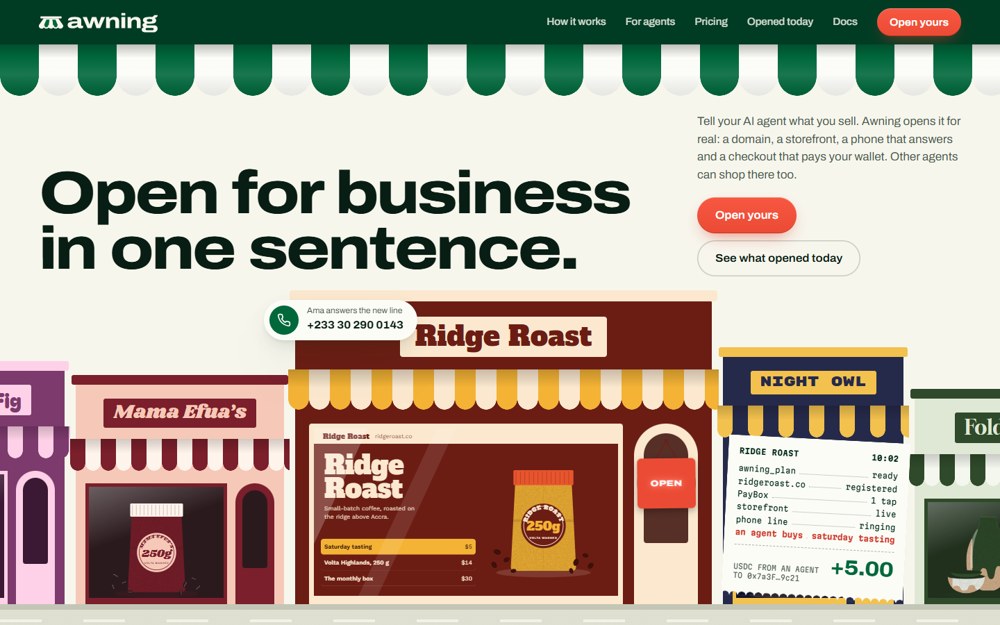
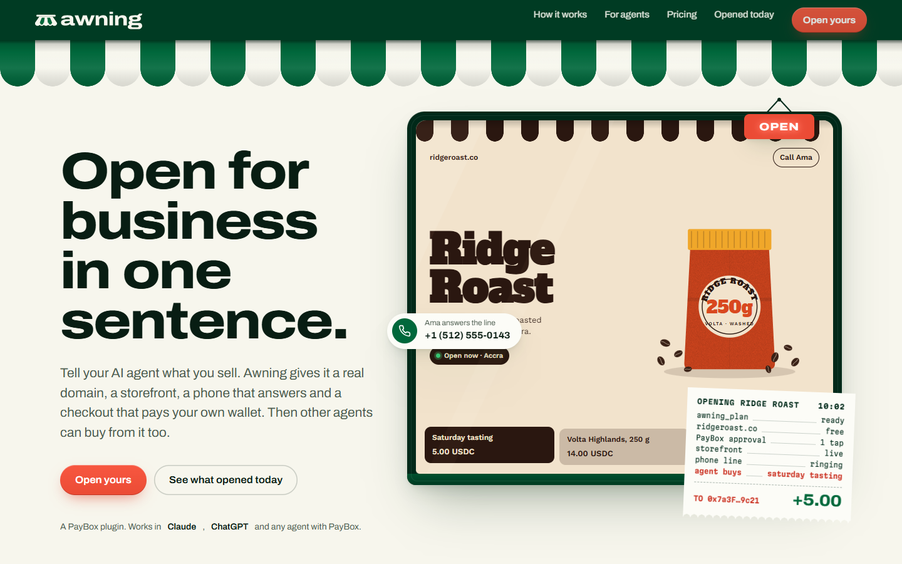
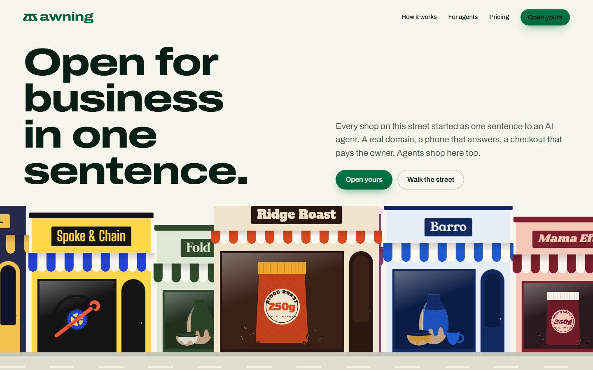
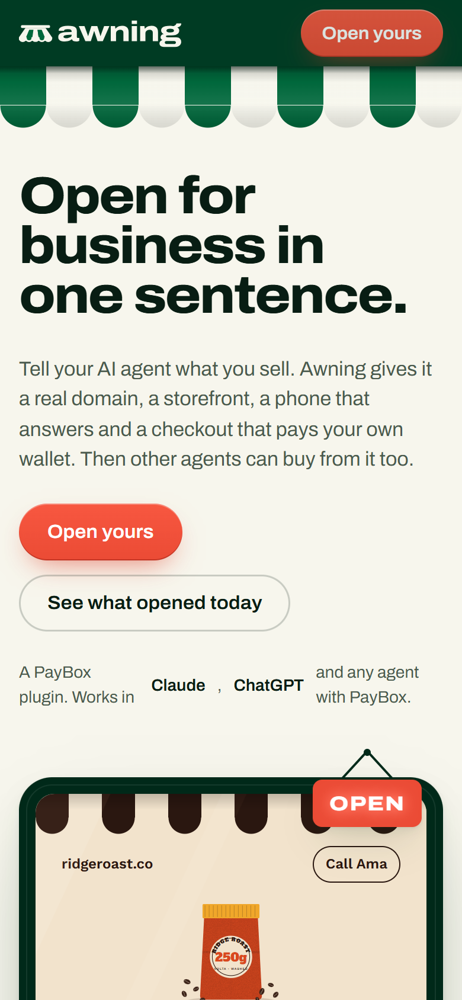
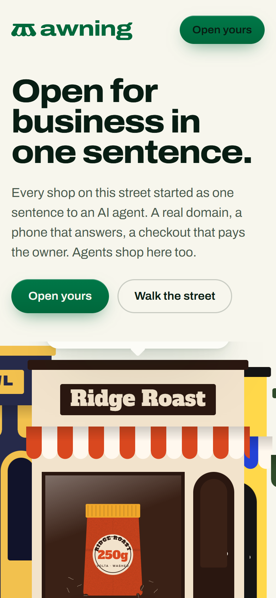
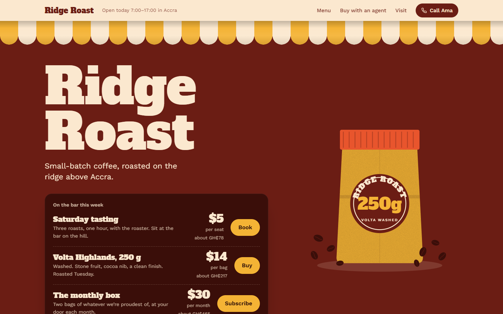
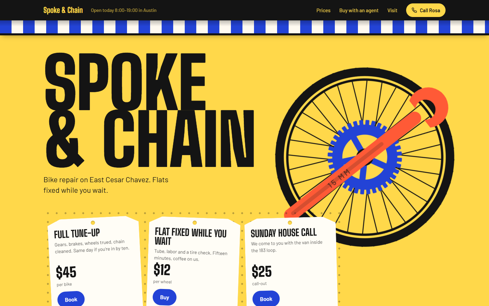
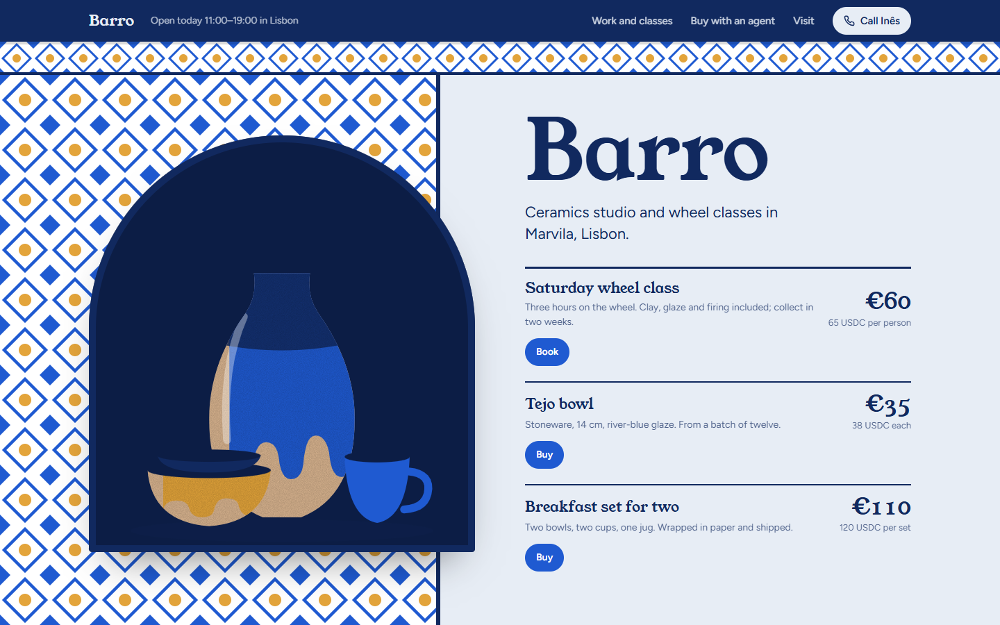
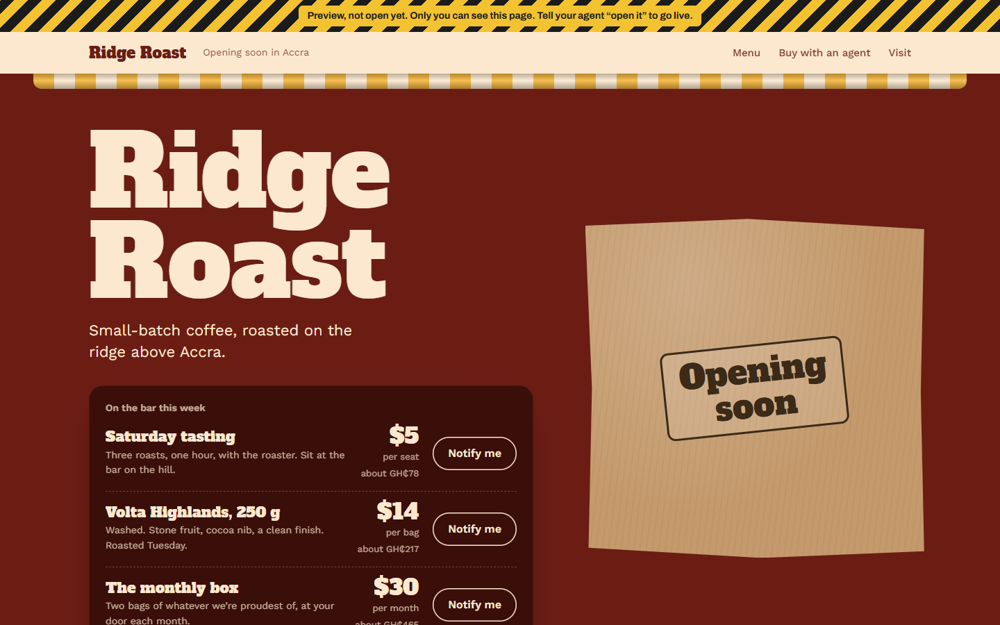

# Awning design direction: "Opening day on the street"

**In three lines.** Awning looks like a street, not a dashboard: awning.sh wears a painted, scalloped canopy in canopy green and canvas, and its first screen is a street of independent shops with a hoarding in the gap, where your sentence is lettered in gold, the hoarding lifts, and a new shop opens with its own sign, awning and website in the window, its phone rings and an agent's first 5 USDC prints on a receipt. Every generated business gets its own palette, font pair, canopy and category-specific layout (menu board, pegboard of price tags, gallery wall), so it reads as an independent shop with a slim "Opened with Awning" ribbon. Money is always a receipt, a ticket or a price tag, never a dashboard.

## How we got here (studio method, lean)

1. **References** from the taste library (424 captured and annotated sites, calibrated jury): food and indie-commerce award winners plus payments brands that refused the dashboard look. Boards: `moodboards/refs-landing.png`, `moodboards/refs-storefront.png`. What each teaches is in `BRAND.md`.
2. **Brand first** (`BRAND.md`): essence "Open"; tension corner-shop warmth × machine-exact payments; mark = a front-view awning; Archivo across its width axis; canopy green + canvas + one tomato accent; the street as the single image language.
3. **Three concepts**, two built in code:
   - **A. Opening day (built; its window, sign and receipt survive):** the page *is* a shopfront. A canopy crowns the screen; the hero is a shop window where the sentence becomes a business, with a hanging OPEN sign, a phone chip and a receipt.
   - **B. The street (built; became the hero in round 3):** every business opened on Awning is a shop on one endless street; the hero builds your shop into an empty lot between the others.
   - **C. The sign painter (rejected at concept stage):** a type-only hero where the sentence is hand-lettered and then re-sets itself into the business's own sign. Rejected: it shows the brand but not the product working (no phone, no payment), and kinetic type alone drifts toward the "broadsheet" cluster.
4. **Executions** at 1440 and 390, screenshotted with Playwright, critiqued against award references, then iterated four rounds (below), with two blind review rounds in between.

## Why A first, and why the final is A + B

| | A · Opening day | B · The street |
|---|---|---|
| Shows the product working in 5 s | Yes: sentence → site → phone → agent purchase → +5.00 | Partly: the shop appears, but the phone and payment are small bubbles that crop |
| Memorability | High: the canopy and the flipping OPEN sign | Highest: a whole street of businesses |
| Brief fit ("hero = the product working") | Exact | Loose |
| Risk | Split hero is a familiar layout | Illustration could read as clip-art; weaker proof |

A won round 1 because the judges' first question is "does it work end to end", and A answers it in one loop; B became the **"Opened today"** section (fed by `/v1/live`) and the **X header**. The blind review after round 2 then showed A's weakness: a familiar split hero with a framed mockup, at standard scale. The final hero merges them: **B's street at poster scale, with A's proof inside it** (the shop window shows the live website, the door carries the OPEN sign, the receipt prints on the pavement).

| A · Opening day (round 1) | B · The street (round 1) |
|---|---|
|  |  |
|  |  |

Sources: `directions/a-shopfront/index.html`, `directions/b-street/index.html`.

## Iterations on the winner

- **Round 1 → 2 (landing):** headline cut from 4 lines to 3; the phone chip moved off the storefront name; the receipt moved off the offers; the mini storefront got a rod, its own canopy and a menu list instead of three tiles; the OPEN sign hangs from a longer chain so it no longer covers the domain; phone layout recomposed (headline → window → copy; receipt hangs below the window instead of covering it); `.stage` collapsed to 0 width on phones (fixed); "how it works" ticket text was inheriting the light paragraph color (fixed); "19.00 USDC" wrapping in the approval sheet (fixed); tool board columns rebalanced; final CTA headline down to 2 lines.
- **Round 2 (storefront):** Spoke & Chain's poster hero dropped its art to a second row (fixed with explicit grid rows); a 1 px seam between the canopy's stripes and scallops on phones (fixed by overlapping the mask layers); the agent prompt lowercased "Saturday" (fixed); a TDZ bug blanked every storefront after the free-plan change (fixed; `tools/errs.mjs` now checks console errors on every page); per-business favicon added.
- **Round 2 polish (copy and chrome):** removed every "A · B · C" meta string (a template-chrome tell); free-plan and draft states hide phone UI.
- **Review 1 → round 3 (the big change).** The first calibrated-scale jury scored the landing **5.46** and the storefront **5.77** (between "ordinary" and Honorable Mention) and the AI test called it AI-made: a standard split hero at standard scale, a framed mockup collage, one storefront skeleton re-skinned three times, Ridge Roast landing in the cream + slab + terracotta cluster. The Arena (vs award references) gave the landing 5/10 desktop wins-or-ties but lost 3 of 4 storefront pairs. Following the studio rule "if rounds stall, change the concept, not the polish", we:
  - rebuilt the hero around concept B: **the street is the hero**; the sentence is lettered on a hoarding in the gap and the new shop opens there, at poster scale, with the website in its window; the headline is set big on two lines;
  - gave each storefront category its **own structure** (menu board / pegboard of price tags / tiled wall with gallery labels), its own canopy (scallop / flat hem / azulejo lintel), prices in the first screen, local currency beside USDC and local phone formats;
  - moved Ridge Roast to an oxblood and gold field (out of the cream cluster); replaced Barro's white cards with gallery labels on a tiled wall;
- **Review 2 → round 4:** the round-3 jury (6.77 / 6.61) caught the rest: the phone CTA now sits right under the street; "Its first customer was an AI" read like a typo ("The first customer was an AI."); storefront art no longer collides with names on phones; a scoping bug that hid the street's signboards.
- **Capture notes:** in review 1 the 390 landing shot rendered unstyled because the local static server dropped the stylesheet request during a batch capture (the page itself was fine; see `shots/round2` vs `shots/final`). In review 2 the 390 full-page shot at 2x exceeded Chrome's 16,384 px capture limit and stitched duplicate tiles; `tools/height.mjs` confirms one copy of each section (9,500 px tall), and full phone pages are now captured at 1x (`tools/fullphone.mjs`).

## Deliverables

| What | Where |
|---|---|
| Brand doc | `design/BRAND.md` |
| Mark, wordmark, lockups (SVG, outlined) | `design/brand/logo*.svg`, `mark*.svg`, `wordmark*.svg` |
| Favicon set, app icon, X avatar | `design/brand/favicon.svg`, `favicon-32/180/512.png`, `app-icon.svg`, `social/avatar-400.png` |
| Tokens (OKLCH) | `design/brand/palette.css` |
| Brand sheet (palette, type scale, buttons, voice) | `design/brand/index.html` → `shots/final/brand-sheet-*.png` |
| OG image 1200×630 | `design/brand/social/og.png` (source `og.html`) |
| X header 1500×500 | `design/brand/social/x-header.png` (source `x-header.html`) |
| Landing (awning.sh) | `design/landing/index.html`, `landing.css`, `landing.js`, `assets/` |
| Storefront template | `design/storefront/index.html?b=<slug>[&state=draft]`, `storefront.css`, `storefront.js` |
| Sample businesses + poster art | `design/shared/businesses.js`, `design/shared/art.js` |
| Project design skill | `.claude/skills/awning-design/SKILL.md` |
| Screenshots (1440 and 390, first screen + full) | `design/shots/final/` (round 2 in `shots/round2/`, directions in `shots/directions/`) |
| Review: jury, Arena, AI test | `design/review/jury.md`, `design/review/arena-verdicts.md`, `design/review/arena/` |
| Tools | `design/tools/` (`shot.sh`, `finalshots.sh`, `sections.mjs`, `errs.mjs`, `render.mjs`, `brand-gen.mjs`) |

## The storefront every business gets

- **Themed from four API colors.** `GET /v1/businesses/:slug` returns `palette {primary, accent, ink, paper}`; `themeFrom()` derives ground, ink, accent, stripes and a deep tone. The category picks the font pair, the canopy and the structure: `sign` for food (huge slab name, a menu board with prices and actions, the poster object; scalloped canopy), `poster` for repair (huge condensed caps over a slowly turning wheel, price tags on a pegboard; flat hemmed canopy), `arch` for studios (the work in an arched window set into a tiled wall, gallery-label prices; azulejo lintel).
- **Real independent-shop anatomy:** their own canopy; the name as a sign; status in the rod ("Open today 7:00–17:00 in Accra"); offers with prices and actions in the first screen, in dollars with the local currency beside them; local phone formats; a "Buy with your AI agent" slip with the exact prompt and the x402 link (`https://api.awning.sh/x402/b/:slug/:sku`) plus the payTo wallet; about, hours, call; the Awning ribbon.
- **Draft ("Preview, not open yet"):** caution-tape bar, canopy rolled up, kraft paper over the window with an "Opening soon" stamp, buy buttons become "Notify me", no phone shown.
- **Integration notes for `web/` (W-A):** port `storefront.css` as-is (all values are CSS variables set on `:root`), render the markup in `storefront.js` server-side in `/s/[slug]`, set the variables from `themeFrom(business.palette)` and the category row in `BY_CATEGORY`, and load the two Google fonts for the category. Offer ids map to `sku`. Hide phone UI when `business.phone` is empty.

## Landing integration notes

- `landing/` is static; port to the root host of the Next.js app. Assets are in `landing/assets/`; OG at `landing/og.png`.
- The street reads sample data now; `landing.js` has the `GET /v1/businesses?live=1` hook commented in place. Never show invented counters; when the API answers, use real openings and last sales.
- Fonts: Archivo + Martian Mono for Awning; the storefront fonts only for the street's signboards (they can be subset to the business names).

## Self-critique (studio review format)

Evidence: `review/jury.md` (round 2), `review/jury-r3.md` (round 3, after the street hero), `review/arena-verdicts.md` and `review/arena-r3-verdicts.md` (blind pairs; keys in `review/arena*/**.key.json`), `review/crowd-default.html` (the crowd-default mock). Anchors: Shopify Editions Winter '26 (SOTY level), 2-c.earth (HM), greatlakestheater.org (ordinary). The jury here is three specialists in one agent, not the seven separate calibrated judges studio asks for, so treat the numbers as indicative.

| | Round 2 | Round 3 (street hero, per-category storefronts) | Studio bar |
|---|---|---|---|
| Jury, landing | 5.46 | **6.77** (HM level) | ≥ 7.5 ✗ |
| Jury, storefront system | 5.77 | **6.61** (Ridge ~6.9, Spoke ~6.5, Barro ~6.0) | ≥ 7.5 ✗ |
| Arena desktop (wins or ties of 10) | 5 | **7** (landing 6/6; storefront 1/4) | ≥ 4 ✓ |
| Arena phone (of 5) | 2 valid wins (3 pairs void: broken capture) | **5** | ≥ 2 ✓ |
| vs crowd-default mock | won 6.46 vs 4.84 | won 6.70 vs 4.80 (desktop), 6.66 vs 4.64 (phone) | clearly ✓ |
| AI test | "AI-made, better than average" | "AI coding assistant, well directed (~70%)" | 2 of 3 say human ✗ |
| Console errors / horizontal scroll at 390 | none | none | ✓ |
| Lighthouse | not run | not run | ≥ 90 ? |

Barro was improved after the round-3 jury (tiled wall, labels instead of white cards); it has not been re-judged.

**Three strongest points**
1. **One idea runs through everything.** The canopy, the hoarding, the OPEN sign, the receipt, the price tags and the street all come from "a shop that just opened". The hero shows the whole product loop (sentence, domain, website, phone, agent purchase, +5.00 to the owner's wallet) in one scene, and the phone version is composed, not shrunk. Blind judges preferred it to all six award-level landing references and to the crowd default by about 2 points.
2. **Generated storefronts look like independent shops.** Each one has its own palette, fonts, canopy and category layout (menu board, pegboard, tiled wall), prices in the first screen, local currency and phone formats, an honest "Buy with your AI agent" slip with the exact prompt and x402 link, and a designed "Preview, not open yet" state (rolled canopy, papered window, "Notify me"). It renders from the API's four-color palette and the category alone.
3. **A system other agents can follow.** OKLCH tokens, outlined SVG marks that hold at 16 px, a favicon set, OG and X header rendered from code, a brand sheet, reproducible screenshot and review tools, and `.claude/skills/awning-design/SKILL.md` with the rules, components and the tells to reject.

**Three weakest points**
1. **Imagery is the ceiling.** All art is flat SVG built in code. Every judge said it reads as code-drawn next to photographic award sites (Savor, Mana, Abel), and it is the main reason the AI test still says "AI-made". The fix is an image route: per-business generated or commissioned illustration or photography (needs an image generator from the user), plus a hand-drawn Awning lettering pass.
2. **Below the hero, the page is still a stack of modules** (three beats, street, tools, price tags, trust, CTA), and the middle switches from shop-owner voice to USDC, Base and x402. Judges asked for fewer, larger scenes, a walk down the street, and a separate /for-agents page for the tool table.
3. **The jury bar (7.5) is not met, and the review was lean.** We reached Honorable Mention level (6.6–6.8), not award level; the jury was not the full seven-judge calibrated panel, the eleven detail specialists and Lighthouse were not run, and the street on "Opened today" still shows sample businesses until `/v1/live` is wired.
