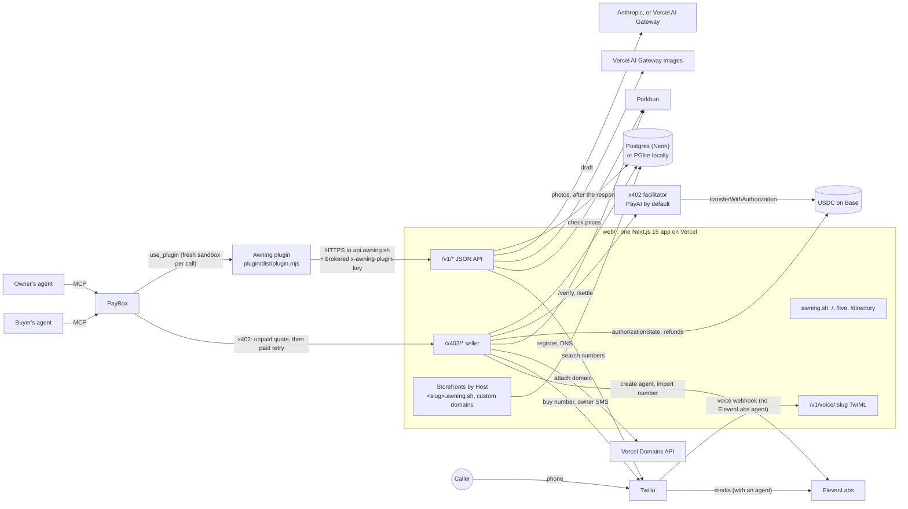
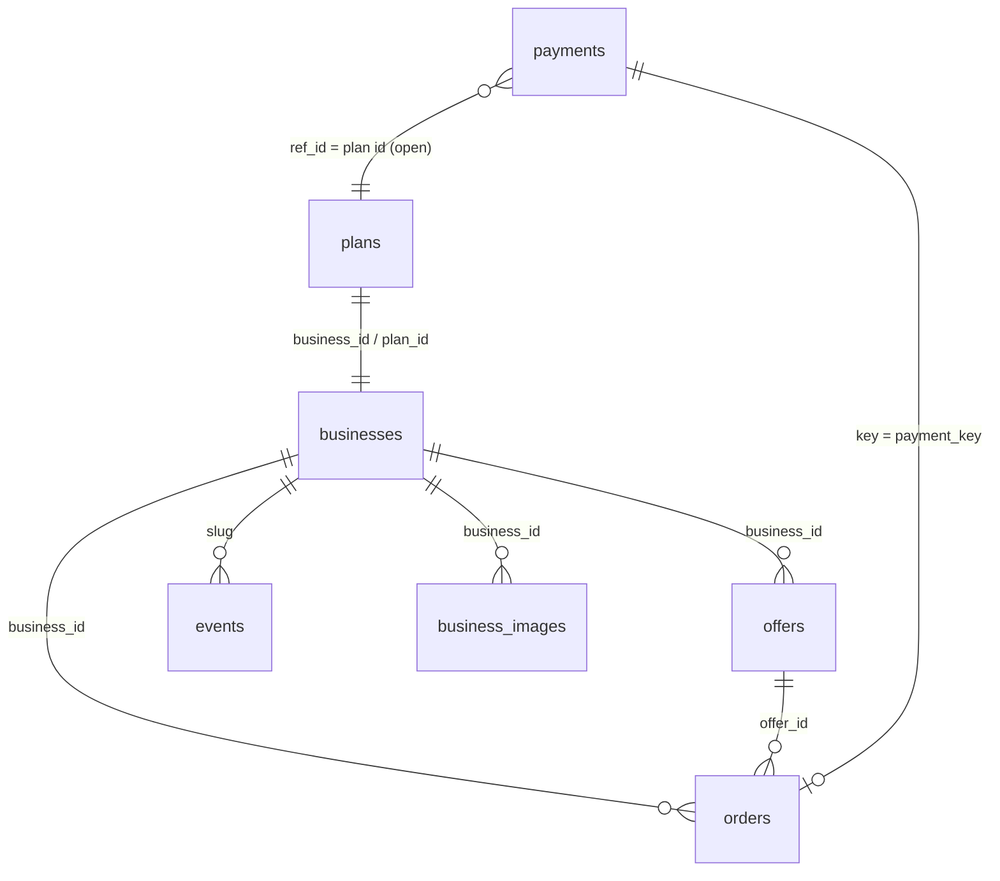

# Awning architecture

Status: describes the code on `main` as of 2026-10-17. File paths are relative to the repository root.

## System



| Component | Code | Runs |
|---|---|---|
| Plugin | `plugin/src/*.ts`, bundled to `plugin/dist/plugin.mjs` | In the PayBox sandbox, one fresh process per call |
| JSON API | `web/app/v1/**` | Vercel functions |
| x402 seller | `web/app/x402/**`, `web/lib/x402/*` | Vercel functions, `maxDuration = 30` |
| Opening orchestrator | `web/lib/orchestrator/machine.ts`, steps in `web/lib/services/open.ts` | Inside the paid `/x402/open` request |
| Provider adapters | `web/lib/adapters/*` | Called from services; mock when keys are missing |
| Trust and safety | `web/lib/policy/*` (screening, quotas, reports, takedown) | Inside `/v1/plan`, `/v1/open-free`, offer creation, the x402 quotes, `/v1/reports`, `/v1/admin/*` |
| Storefront photography | `web/lib/services/images.ts`, `web/lib/plan/photos.ts`, `web/app/img/[id]/route.ts` | Scheduled with Next.js `after()` once the plan response is sent |
| Storefronts, landing, `/live`, `/directory` | `web/app/**`, routing in `web/middleware.ts` and `web/lib/host.ts` | Same Vercel project |
| Database | `web/lib/db/schema.ts`, migrations in `web/drizzle/` | Neon over HTTP (`@neondatabase/serverless`), or embedded PGlite when `DATABASE_URL` is unset |

## The plugin sandbox

The plugin is a standard MCP server (`@modelcontextprotocol/server` 2.0.0, protocol `2026-07-28`) built from PayBox starter 1.0.2. The PayBox contract ([developer guide](https://docs.paybox.sh)) sets its shape:

- **Stateless.** Every operation runs in a fresh sandbox. Nothing in memory or on disk survives between calls. All state lives in the Awning API.
- **10-second budget** per hosted operation, including startup. The plugin does no network I/O at startup or during tool discovery.
- **One network host:** `api.awning.sh`. The API base can be overridden with `AWNING_API_URL`, which must be a plain `https://` URL (or `http://localhost`/`127.0.0.1` for local runs) without credentials, query or fragment ([`plugin/src/awning.ts`](../plugin/src/awning.ts) `apiBase`).
- **Brokered header.** PayBox adds `x-awning-plugin-key` to requests for `api.awning.sh` at egress. The plugin never reads or sends it, and PayBox withholds any output containing its literal value.
- **Bounded requests.** 4 s timeout per request (`FETCH_TIMEOUT_MS`), 8 s for `awning_plan` (`PLAN_TIMEOUT_MS`), `redirect: "error"`, responses over 1,000,000 characters rejected.
- **Money only through proposals.** `awning_open` and `awning_buy` return one `io.paybox/transactionProposal` of kind `x402` built by the starter's `proposeX402`. The sandbox invocation ends before approval; the paid response reaches the agent through the PayBox request, not through the plugin.
- **Proposal amount is checked twice.** Before proposing, the paid tools read Awning's stored price and the unpaid 402 challenge in parallel and refuse if they differ. PayBox then checks the live 402 against `maxAmount` again before asking for approval.
- **Errors** are `isError: true` results with one sentence that says what to do next. Upstream payloads, headers and tokens are never returned in errors.

Tool reference: [PLUGIN.md](PLUGIN.md).

## The API

All routes are Next.js route handlers wrapped by `handler()` ([`web/lib/api.ts`](../web/lib/api.ts)), which turns an unexpected exception into `500 {error: "internal_error", message: "Something went wrong (err_…)."}` with no stack or secret. JSON bodies are parsed by `parseBody` (64 KiB limit, empty body = `{}`, first zod issue as the message).

| Auth class | Check | Routes |
|---|---|---|
| Public | none; CORS `*` on GETs | `GET /v1/health`, `/v1/businesses`, `/v1/businesses/:slug`, `/v1/businesses/:slug/offers`, `/v1/live`, `/img/:id`; `POST /v1/reports` |
| Operator | `x-awning-admin-key` equals `AWNING_ADMIN_KEY` (constant-time); unset key → `503` | `POST /v1/admin/businesses/:slug/status` |
| Plugin | `x-awning-plugin-key` equals `AWNING_PLUGIN_KEY` (constant-time). Unset key: allowed in development, `503 misconfigured` in production | `POST /v1/plan`, `GET /v1/plans/:planId`, `POST /v1/open-free` |
| Plugin + owner | plugin key, and `x-awning-owner-token` for that business | `POST /v1/businesses/:slug/offers`, `GET /v1/orders` |
| x402 | none (PayBox cannot send custom headers on payment requests); the payment is the authorization | `/x402/open/:planId`, `/x402/b/:slug/:sku` |
| Twilio | `X-Twilio-Signature` HMAC-SHA1 when `TWILIO_AUTH_TOKEN` is set | `POST /v1/voice/:slug` |

Endpoint reference: [API.md](API.md).

## Planning (`POST /v1/plan`)

Everything slow happens here, so the paid opening only has to provision. A sentence that breaks the acceptable use policy is refused before any provider call; a draft that breaks it is refused before anything is stored ([`web/lib/services/plans.ts`](../web/lib/services/plans.ts) `createPlan`).

```mermaid
sequenceDiagram
  participant P as Plugin
  participant A as API
  participant L as Anthropic
  participant R as Porkbun
  participant T as Twilio
  P->>A: POST /v1/plan (8 s client timeout)
  A->>A: screen the sentence; check the wallet's plan quota (block → 422 / 429, nothing stored)
  A->>A: template draft (instant)
  par in parallel
    A->>R: checkDomain(template name candidates), 8 s
    A->>T: search local numbers, 5 s
    A->>L: LLM draft (Anthropic or AI Gateway), AWNING_LLM_TIMEOUT_MS = 4.5 s
  end
  alt LLM renamed the business
    A->>R: checkDomain(new candidates), max(1.2 s, 6.5 s − elapsed)
    Note over A: no answer in time → fall back to the template so name and domains agree
  end
  A->>A: screen the draft (name for brand impersonation, copy, offers)
  A->>A: finalize offers, pick 3 domains, receptionist prompt, DNS records
  A->>A: insert business (draft), offers, plan (quoted)
  A-->>P: 201 plan
  A->>A: after the response: generate two photos (capped per hour)
```

What a plan stores in `plans.prepared`: the receptionist name, system prompt and first message; the DNS records (`A @ 76.76.21.21`, `CNAME www cname.vercel-dns.com`, overridable); up to three phone number candidates and the country; and whether the draft came from the LLM or the template. `plans.domains` stores, per domain, the registrar price in cents and atomic USDC and the Pro total in atomic USDC.

The LLM (Anthropic's Messages API with a forced tool call, or the Vercel AI Gateway with a strict JSON schema and reasoning off; [`web/lib/adapters/drafter.ts`](../web/lib/adapters/drafter.ts)) proposes and fixed rules decide (`finalizeDraft`): lengths are clipped, the category must come from the catalogue, the palette must reach contrast 7:1 (ink on paper) and 3:1 (paper on primary) or the template palette is used, prices are rounded to cents and clamped to $1–$10,000, duplicate titles are dropped, prices the owner stated are added if missing, and offers are padded to at least 3 and cut to 5.

## The opening orchestrator

A Pro opening is a saga that runs inside the paid x402 request, between payment verification and settlement ([`web/lib/services/open.ts`](../web/lib/services/open.ts) `openPro`, [`web/lib/orchestrator/machine.ts`](../web/lib/orchestrator/machine.ts) `runSaga`).

**Quote-bound.** The amount charged is `plans.domains[].totalAtomic`, fixed at plan time. The `preflight` step re-checks the registrar and fails if the domain is gone or its price in cents changed; `register_domain` passes the quoted cents to Porkbun, which refuses a different live price. A price change can therefore only cause a failure before settlement, never a different charge.

**Idempotent.** Four layers:

1. *Per payment.* The x402 idempotency key is the signed authorization (`network:asset:payer:nonce`). A key seen before replays its stored response ([below](#x402-seller)).
2. *Per plan.* The work starts by claiming the plan with a conditional update: `quoted`, or `opened` + `free` (upgrade), or `opening` older than 3 minutes (a crashed attempt). A plan already `opened` + `pro` is never provisioned again; that payment is answered `alreadyOpen: true, charged: false` and not settled. A plan being opened by another payment answers `409 open_in_progress` and releases the key so the payer can retry.
3. *Per provider.* Porkbun registration uses `Idempotency-Key: awning-open-<planId>-<domain>`, DNS records use `awning-dns-<planId>:<i>`, and Vercel's "already attached to this project" counts as success. A preflight that finds the domain already in Awning's registrar account continues, and the registration call replays the earlier one.
4. *Per business.* The owner token is derived from the business id, so a retried open returns the same token.

**Steps** (in order; each has its own timeout, capped by what is left of the shared deadline `AWNING_OPEN_DEADLINE_MS`; a step that would start with 250 ms or less left fails):

| # | Step | Provider call | Timeout | Undo |
|---|---|---|---:|---|
| 1 | `preflight` | registrar `check` of the chosen domain | 6 s | none needed |
| 2 | `phone` | Twilio: buy a plan-time candidate, else search again (falls back to US); voice webhook → `/v1/voice/:slug` | 9 s | release the number |
| 3 | `receptionist` | ElevenLabs: create the agent from the prepared prompt, pointed at the chosen domain | 9 s | delete the agent |
| 4 | `connect_phone` | ElevenLabs: import the Twilio number with `agent_id`. Skipped when either side is a mock | 9 s | delete the import |
| 5 | `hosting` | Vercel: add `domain` and `www.domain` (308 → apex) | 8 s | remove both |
| 6 | `register_domain` | Porkbun `domain/create` at the quoted cents | 15 s | none: irreversible, so it runs last among the costly steps |
| 7 | `dns` | Porkbun: delete parking records, create `A` and `CNAME` (1 retry) | 8 s | none |
| 8 | `go_live` | DB: business `live`, `package = pro`, plan `opened`, `opened` event | — | — |

`go_live` runs inside `commit`, after settlement. Every step records `{name, status, ms}`; the response returns them as `steps`.

**Compensation.** When a step fails, the completed steps are undone in reverse order, each with an 8 s timeout. An undo that fails marks its step `compensation_failed` and logs an error; the resource stays and needs manual cleanup. The same undo runs if settlement fails, or if the commit fails after settlement. The plan returns to `quoted` (or `opened` + `free` for an upgrade) with `last_error` set. A registered domain is not undone; it stays in Awning's registrar account, and the next opening attempt for that plan reuses it.

**Deadline.** `env.openDeadlineMs()` defaults to **20000** ms in [`web/lib/env.ts`](../web/lib/env.ts); `.env.example` and `web/README.md` say 14000. See [latency budgets](#latency-budgets).

## x402 seller

Both paid endpoints use one lifecycle, `handlePaidRequest` in [`web/lib/x402/flow.ts`](../web/lib/x402/flow.ts), with the 402 construction and payment matching in [`web/lib/x402/seller.ts`](../web/lib/x402/seller.ts) (`@x402/core` and `@x402/evm` 2.28.0).

| | `POST /x402/open/:planId` | `POST /x402/b/:slug/:sku` |
|---|---|---|
| Amount | the plan's `totalAtomic` for the domain | offer price × qty |
| `payTo` | `AWNING_TREASURY_ADDRESS` | the owner's wallet (`businesses.owner_wallet`) |
| Work before settlement | the provisioning saga | insert the order (`pending`) |
| Commit after settlement | business live, plan opened, event | order `paid`, `sales_count + 1`, event, owner SMS (capped at 3 s) |
| Refundable by Awning | yes, from the treasury | no: the money is in the owner's wallet |

```mermaid
sequenceDiagram
  participant PB as PayBox
  participant S as Awning /x402
  participant DB as payments table
  participant F as Facilitator
  participant B as USDC on Base
  PB->>S: POST (no payment header)
  S-->>PB: 402 PAYMENT-REQUIRED (v2 header) + v1 JSON body
  Note over S: quote only: no writes, no provider calls
  PB->>S: POST + PAYMENT-SIGNATURE (v2) or X-PAYMENT (v1)
  S->>DB: key seen? → replay stored response (or 409 in progress)
  S->>S: match scheme, network, asset, amount, payTo, validity window
  S->>F: /verify
  S->>DB: insert key, status working (unique; a concurrent duplicate loses)
  S->>S: work (saga, or order row)
  S->>F: /settle (only after the work succeeded)
  alt facilitator answer is not a clean success
    S->>B: authorizationState(payer, nonce)
  end
  S->>S: commit
  S->>DB: store status + response
  S-->>PB: 200 + PAYMENT-RESPONSE, X-PAYMENT-RESPONSE
```

**Unpaid request.** `quoteOpen` / `quoteBuy` read the plan or offer and build the charge. If the request is valid, the response is `402` with the v2 `PAYMENT-REQUIRED` header (base64 JSON, `x402Version: 2`, `amount`, network `eip155:8453`) and a v1 JSON body (`x402Version: 1`, `maxAmountRequired`, network `base`) plus a readable `awning` quote. Building it does no writes and calls no provider (tested in `web/tests/x402-quote.test.ts`). The same quote answers `GET`.

**Paid request**, in order:

1. **Replay first.** Before the quote is recomputed, a payment key with a stored response gets that response again, so a later change (plan expired, offer removed, Pro no longer configured) cannot turn a completed payment into an error. A key without a stored response gets `409 payment_in_progress`.
2. **Exact match.** For v2, the declared `accepted` terms must equal the live quote (scheme `exact`, network `eip155:8453`, asset USDC, amount, payTo). For both versions the signed authorization's `to` and `value` must equal payTo and the amount, `validBefore` must be more than 3 s away, `validAfter` at most 5 s ahead, and the nonce 32 bytes. Any mismatch returns a fresh 402 whose `error` names the reason (`amount_mismatch`, `payto_mismatch`, `wrong_network`, …).
3. **Verify** with the facilitator against the server's own requirements, never the client's. Invalid → 402 with the facilitator's reason.
4. **Claim** the key: insert into `payments` with status `working`. If the insert conflicts, another request owns it: `409 payment_in_progress`.
5. **Work.** Never moves the customer's money. A thrown error becomes `500 work_failed, charged: false`.
6. **Settle** only if the work succeeded. If the facilitator does not return a clean success, USDC's on-chain `authorizationState(payer, nonce)` decides: used → treat as paid (`unconfirmed`); not used → one more settle attempt for transient reasons; definitively refused → failed.
7. **Commit**, store the response, return it with `PAYMENT-RESPONSE` and `X-PAYMENT-RESPONSE`.

**Pay only on success.** Work failure → the authorization is never settled; `502 provisioning_failed` (open) with `charged: false` and the steps. Settlement failure → the work is undone; 402 `settlement_failed`, `charged: false`.

**Refund after settlement.** If the commit fails after the money moved, the work is undone and, for openings (payTo = treasury), the refunder sends the same amount of USDC from the treasury key to the payer and waits for the receipt: `502 {refunded: true, refundTx, reason, charged: true, paidUsd, tx}`, payment status `refunded`. If the refund transfer fails: `502 {refunded: false, refundError, message: "Refund pending…"}`, status stays `settled`, and the log line `REFUND FAILED — manual action required` names the payer and amount. For orders, a commit failure after settlement marks the order `failed` and answers `502 delivery_failed, charged: true`; the buyer must contact the seller.

**Expiry.** Unpaid open requests after `expiresAt` → `410 quote_expired`. Paid requests get `MAX_TIMEOUT_SECONDS` (300 s) of grace so a payment signed just before expiry completes.

**Facilitator.** `HttpFacilitator` uses `@x402/core`'s `HTTPFacilitatorClient` against `AWNING_FACILITATOR_URL` (default `https://facilitator.payai.network`) with a 12 s timeout. `MockFacilitator` (`AWNING_FACILITATOR_URL=mock`) verifies the EIP-3009 signature with viem against the USDC-on-Base EIP-712 domain and settles in memory; it refuses to start in production.

## Multi-tenant hosting

One deployment serves every host. `web/middleware.ts` resolves the tenant from `x-forwarded-host` (or `host`) with the pure function `resolveHost` in [`web/lib/host.ts`](../web/lib/host.ts):

| Host | Tenant | `/` is rewritten to |
|---|---|---|
| `awning.sh`, `www.`, `api.`, `app.`, `localhost`, IPs, `*.vercel.app`, `AWNING_EXTRA_ROOT_HOSTS` | root | unchanged; `/?b=<slug>` → `/s/<slug>` (local preview) |
| `<slug>.awning.sh`, `<slug>.localhost` | that business | `/s/<slug>` |
| anything else | custom domain (`www.` stripped) | `/s/<domain>`; the page looks it up with `getBusinessByDomain` (Pro businesses only) |

`/v1/*`, `/x402/*`, `/_next/*`, `/s/*` and a few static files pass through on every host, so the API works on `api.awning.sh` and on every storefront host. `web/app/s/[slug]/page.tsx` renders the business with its palette: hero, offers with prices, a copyable "Buy with your AI agent" prompt and the x402 URL per offer, the phone line, and "Opened with Awning". Drafts get a "Preview — not open yet" ribbon and `robots: noindex`. Custom domains reach the project because the orchestrator attaches them through the Vercel API and points their DNS at Vercel.

## Data model

Tables in [`web/lib/db/schema.ts`](../web/lib/db/schema.ts). Amounts are atomic USDC in `bigint` columns; all money math is `bigint` in [`web/lib/money.ts`](../web/lib/money.ts). Ids are random base-36 strings with a prefix (`pln_`, `biz_`, `off_`, `ord_`, `evt_`; about 128 bits, [`web/lib/ids.ts`](../web/lib/ids.ts)). There are no foreign-key constraints; references are by id.



| Table | Key columns | Notes |
|---|---|---|
| `plans` | `id`, `business_id`, `sentence`, `owner_wallet`, `owner_name`, `owner_email`, `owner_phone`, `country`, `status` (`quoted`/`opening`/`opened`), `domains` (jsonb), `recommended_domain`, `prepared` (jsonb), `open_package`, `open_payment_key`, `open_domain`, `open_steps`, `last_error`, `expires_at` | One per `POST /v1/plan` |
| `businesses` | `id`, `slug` (unique), `plan_id`, `name`, `tagline`, `description`, `category`, `city`, `palette`, `owner_wallet`, `owner_name`, `owner_phone`, `status` (`draft`/`live`/`suspended`), `package`, `domain` (unique), `phone`, `receptionist_name`, `owner_token_version`, `provisioning` (jsonb: provider ids for undo, mocks used), `sales_count`, `opened_at` | |
| `offers` | `id`, `business_id`, `sku` (unique per business), `title`, `description`, `kind`, `price_atomic`, `active`, `position` | |
| `orders` | `id`, `business_id`, `offer_id`, `slug`, `sku`, `qty`, `unit_atomic`, `total_atomic`, `payer`, `pay_to`, `network`, `payment_key` (unique), `status`, `tx`, `buyer_note`, `buyer_contact`, `fulfillment` (jsonb), `error`, `paid_at` | |
| `events` | `id`, `type` (`opened`/`order`/`call`/`report`/`moderation`), `slug`, `name`, `amount_atomic`, `tx`, `data`, `at` | `/v1/live` returns only `opened`, `order` and `call`, never `data`. Reports (reason, details, contact, reporter id) and moderation actions are internal |
| `business_images` | `id`, `business_id`, `role` (`hero`/`detail`, unique per business), `prompt`, `model`, `mime`, `width`, `height`, `bytes`, `data_b64`, `created_at` | Generated WebP photos, schema in [`web/lib/db/images.ts`](../web/lib/db/images.ts) |
| `payments` | `key` (PK: `eip155:8453:<usdc>:<payer>:<nonce>`), `purpose` (`open`/`order`), `ref_id`, `status`, `x402_version`, `network`, `asset`, `payer`, `pay_to`, `amount_atomic`, `tx`, `refund_tx`, `error`, `response` (jsonb: status, body, headers) | One row per accepted authorization; the idempotency store |

Migrations are generated with drizzle-kit into `web/drizzle/` and applied automatically on first connection unless `AWNING_AUTO_MIGRATE=0`.

## Latency budgets

| Path | Budget | Where it is set |
|---|---|---|
| Hosted plugin operation | 10 s | PayBox |
| Plugin → API, every tool except `awning_plan` | 4 s per request (the paid tools make two in parallel) | `FETCH_TIMEOUT_MS`, `plugin/src/awning.ts` |
| Plugin → `POST /v1/plan` | 8 s | `PLAN_TIMEOUT_MS` |
| `POST /v1/plan`, server side | target under about 6.5 s: LLM 4.5 s (`AWNING_LLM_TIMEOUT_MS`), second domain check `max(1.2 s, 6.5 s − elapsed)`, phone search 5 s | `web/lib/services/plans.ts` |
| First domain check inside `/v1/plan` | 8 s (not bounded by the 6.5 s target; see failure modes) | `checkFor(…, 8000)` |
| `/v1/plan`, `/x402/*` functions | 30 s | `maxDuration` |
| Facilitator `/verify`, `/settle` | 12 s each; settle up to 2 attempts | `HttpFacilitator` |
| `authorizationState` read | 6 s per attempt | `HttpFacilitator.authorizationUsed` |
| Opening saga | `AWNING_OPEN_DEADLINE_MS` (code default 20 s), per-step caps above | `web/lib/env.ts`, `proSteps()` |
| Each undo | 8 s | `compensate` |
| Owner SMS after an order | waits at most 3 s | `buy` commit |
| Refund transfer | RPC 10 s, receipt wait 20 s | `ViemRefunder` |
| Signed authorization | 300 s | `MAX_TIMEOUT_SECONDS` |
| PayBox proposal | at most 4 min, never past the plan's expiry; refused with under 60 s left | `proposalExpiry` |

The paid open has no end-to-end bound below `maxDuration`: verify (12 s) + saga (20 s) + two settle attempts with chain checks (2 × (12 s + 6 s)) can exceed 30 s in the worst case. Typical calls are far shorter, but the bound is not enforced. See failure modes.

## Failure modes

| Failure | What happens | Money | Where |
|---|---|---|---|
| Plugin cannot reach the API or it times out | `isError` with "Nothing was changed or paid; retry once". For `awning_plan` a draft may still have been created server side | none moves | `plugin/src/awning.ts` |
| Sentence or draft breaks the acceptable use policy | `422 policy_blocked {category}`; nothing stored | none | `createPlan`, `web/lib/policy/screen.ts` |
| Wallet over its plan or free-opening quota | `429 rate_limited`, `retry-after` | none | `web/lib/policy/safety.ts` |
| Business suspended | quotes, opening and offers refused with `403 business_suspended` | none | `quoteOpen`, `quoteBuy`, `openFree` |
| LLM slow or failing | template draft; domains match the template name | none | `createPlan` |
| Photo generation fails or hits the hourly cap | logged; the storefront keeps its drawn art | none | `generateBusinessImages` |
| Registrar check fails during planning | no domains resolve; all three options are unavailable; Pro cannot be bought; Free still works | none | `checkFor`, `pickDomains` |
| First domain check slow (up to 8 s) | `/v1/plan` can exceed the plugin's 8 s wait; the plugin reports a timeout although a plan was created | none | `createPlan` |
| Quote expired | unpaid: `410 quote_expired`; paid within 300 s: completes | none / normal | `quoteOpen` |
| Pro providers not all real (real facilitator) | `503 pro_unavailable {missing}`, no challenge | none | `readiness.ts` |
| Treasury address missing | `503 misconfigured` on `/x402/open` | none | `quoteOpen` |
| Domain taken or price changed between plan and payment | `preflight` fails, nothing to undo, `502 provisioning_failed` | not settled | `proSteps` |
| Twilio number taken since planning | next candidate, then a fresh search, then US numbers | none | `TwilioTelephony.buy` |
| Provider error mid-saga | completed steps undone in reverse; `502 provisioning_failed` with steps | not settled | `runSaga` |
| An undo fails | step marked `compensation_failed`, error logged, resource left in place | not settled | `compensate` |
| DNS fails after registration | other steps undone; the domain stays registered in Awning's account and is reused on the next attempt | not settled; Awning bears the domain cost | `proSteps` |
| Settlement refused | work undone; 402 `settlement_failed`, `charged: false` | not moved | `handlePaidRequest` |
| Facilitator timeout and chain unreadable | treated as paid; payment `unconfirmed`; needs reconciliation (no job exists) | unknown | `settleWithTruth` |
| Commit fails after settlement (open) | work undone, treasury refund, `502 refunded: true` | refunded | `handlePaidRequest` |
| Refund transfer fails | `502 refunded: false`, `REFUND FAILED` log, status `settled` | held by Awning until a manual refund | `handlePaidRequest` |
| Commit fails after settlement (order) | order `failed`; `502 delivery_failed, charged: true` | with the owner | `buy` |
| Same paid request sent twice | stored response replayed byte for byte; in flight → `409 payment_in_progress` | settled once | `replayIfSeen` |
| Second payment for an open plan | `200 alreadyOpen: true, charged: false`; owner token only to the original payer | not settled | `openPro` |
| Two payments open the same plan at once | the loser gets `409 open_in_progress`; its key is released for retry | loser not settled | `openPro` |
| Function killed at `maxDuration` mid-request | payment row stays `working` (that authorization replays 409 forever); plan stays `opening` until another payment takes it over after 3 min; provider resources from completed steps are not undone; if killed after settlement, the money moved with no commit and no refund | depends on where it stopped | gap; no reconciler |
| Database down | `GET /v1/health` 503; routes `500 internal_error` | none moves before the DB claim | `handler` |
| Twilio webhook with a bad signature | `403` | none | `/v1/voice/:slug` |
| Owner SMS slow or failing | receipt returned after at most 3 s; failure logged | normal | `buy` |

## Deployment

- One Vercel project, root `web/`, Node 24. Domains `awning.sh`, `www.awning.sh`, `api.awning.sh` and the wildcard `*.awning.sh`. Custom business domains are added by the orchestrator.
- Secrets in environment variables (see `.env.example`); locally, the repo-root `.env` is loaded by `web/next.config.ts`.
- CI ([`.github/workflows/ci.yml`](../.github/workflows/ci.yml)) on Ubuntu 24.04 with Node 24.21.0 and pnpm 11.11.0: the plugin's official starter test (type-check, two builds with identical bytes, conformance), the plugin unit checks, and a deterministic-build check; then the web type-check, vitest suite (with `AWNING_FORCE_MOCKS=1` and the mock facilitator) and `next build`.
