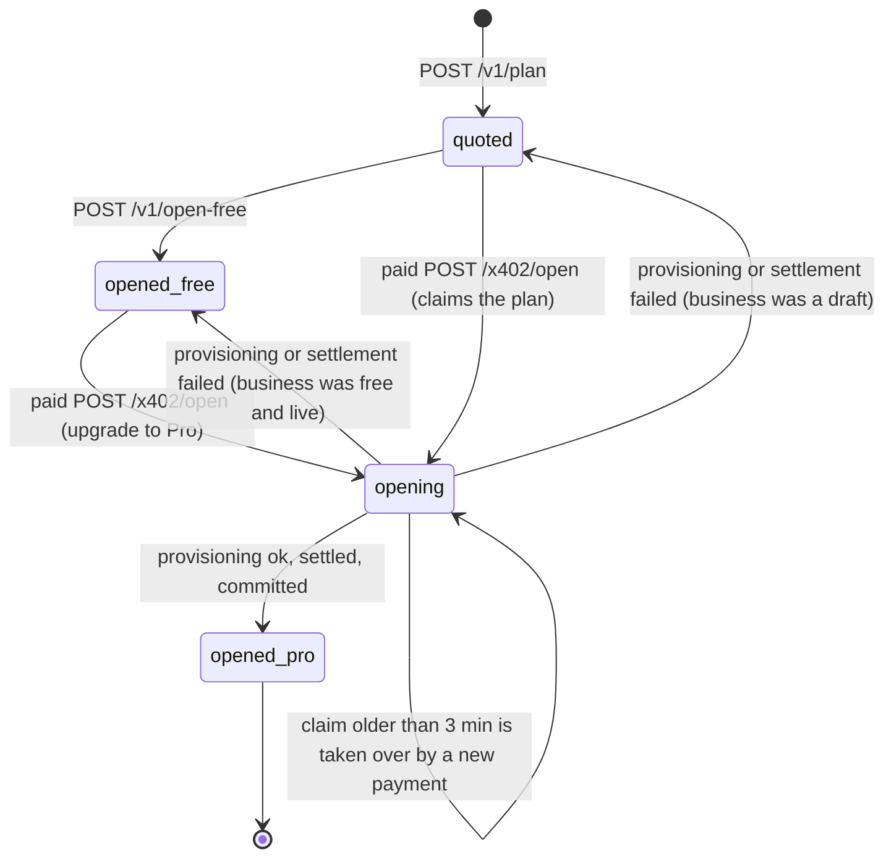
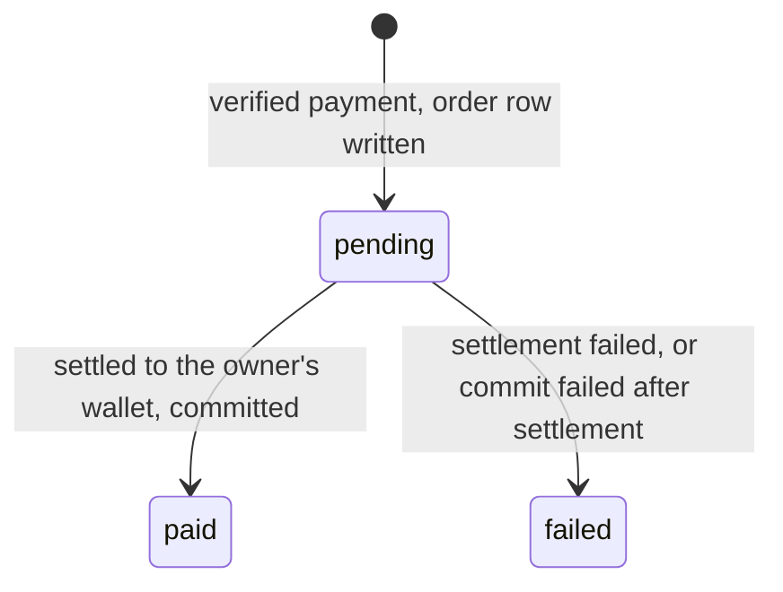

# Awning product specification

Status: describes the code on `main` as of 2026-10-17. Where this document and the code disagree, the code is right and this document has a bug.

## What Awning does

Awning turns one sentence into a working small business that people and AI agents can buy from.

An owner tells their AI agent what they sell, for example *"Ridge Roast, small-batch coffee from Accra, ship bags and sell a $5 tasting session."* Through the Awning plugin for [PayBox](https://www.moonpay.com/newsroom/moonpay-paybox), Awning:

1. drafts the business: name, tagline, description, category, colour palette and 3 to 5 priced offers;
2. checks real domain availability and registrar prices;
3. serves a private draft storefront the owner can look at;
4. opens it, either **Free** (a storefront at `<slug>.awning.sh`) or **Pro** (a registered custom domain, plus a phone number with an AI receptionist that answers it when the server has a real phone provider);
5. lists it in the public Awning directory, where any PayBox agent can find it and buy from it with USDC on Base. Every sale is paid **straight to the owner's own wallet**.

Awning never holds sales money. The only payment Awning receives is the Pro opening fee.

## Who it is for

| Person | What they want | How they reach Awning |
|---|---|---|
| **Owner** | A business that can take money today, without building a website, a checkout or a phone line | Their AI agent (any host PayBox supports) with the Awning plugin enabled |
| **Buyer** | To buy something by asking their agent | Their agent calls `awning_find` and `awning_buy`; the payment is a PayBox x402 approval |
| **Visitor** | To see a business or call it | The storefront (`<slug>.awning.sh` or the custom domain), the directory at `awning.sh/directory`, the phone number |

## Concepts

| Concept | What it is | Where it lives |
|---|---|---|
| **Plan** | A quote: the draft, three domain options with exact prices, and everything the paid opening needs, prepared in advance. Expires after `AWNING_PLAN_TTL_SECONDS` (default 1800). | `plans` table |
| **Business** | The storefront and its public facts. Starts as `draft`, becomes `live` when opened. | `businesses` table |
| **Offer** | Something a buyer can pay for: `product`, `service`, `booking`, `digital` or `subscription`, with a price in whole cents. | `offers` table |
| **Order** | One purchase of one offer, `qty` 1 to 100, paid over x402 to the owner's wallet. | `orders` table |
| **Payment** | One accepted x402 authorization, used as the idempotency key for paid requests. | `payments` table |
| **Owner token** | `awn_ot_…`, a secret that proves ownership of one business. Needed to add offers and read orders. | Derived, not stored ([`web/lib/api.ts`](../web/lib/api.ts)) |
| **Package** | `free` or `pro`. | `businesses.package`, `plans.open_package` |

## User journeys

Tool names are the plugin's ([PLUGIN.md](PLUGIN.md)); endpoints are the API's ([API.md](API.md)).

### Owner: plan, then open for free

1. The owner writes one or two sentences and gives the Base wallet address that should receive sales.
2. The agent calls `awning_plan` → `POST /v1/plan`. Awning screens the sentence against its acceptable-use policy and the wallet's quota, drafts the business, screens the draft (including the name, for brand impersonation), checks domains, and stores a **draft** business and a **plan** (status `quoted`). No money moves and nothing is registered. A prohibited business gets `422 policy_blocked` and nothing is stored.
3. The agent shows the name, offers, the preview link (`https://<slug>.awning.sh`, marked "Preview — not open yet" and `noindex`) and the prices, then asks how to open.
4. The owner picks Free. The agent calls `awning_open_free` → `POST /v1/open-free`.
5. The business becomes `live` on `https://<slug>.awning.sh`, appears in the directory and in `GET /v1/businesses`, and an `opened` event appears on `/live`.
6. The response carries the **owner token**. The agent gives it to the owner to keep. A repeated call within 10 minutes of a free opening returns the same token again; after that, `POST /v1/open-free` answers `ownerToken: null` and never re-issues it (and never for a Pro business).

### Owner: plan, then open Pro

Steps 1 to 3 as above. Then:

4. The owner picks a domain. The agent calls `awning_open` with the `planId`, the domain and its exact `openPriceUsd`.
5. The plugin re-reads the plan and Awning's live 402 quote. If the prices agree, it returns a PayBox x402 **proposal** for exactly that amount. It does not pay.
6. PayBox fetches the live 402 challenge, checks the asset and amount against the proposal, and asks the owner to approve.
7. PayBox sends the paid request to `POST /x402/open/:planId`. Awning verifies the payment, provisions the phone number, the receptionist, hosting, the domain registration and DNS, and only then settles the payment.
8. The paid response (live URL, phone number, owner token, receipt, step timings) comes back through the PayBox request. The agent polls that request and does not call `awning_open` again.
9. If provisioning fails, the payment is **never settled** and the response says `charged: false`. If something fails after settlement, Awning refunds the payer from its treasury and the response says `refunded: true`.

### Buyer agent: find, then buy

1. The buyer asks their agent for something ("a coffee tasting in Accra").
2. The agent calls `awning_find` → `GET /v1/businesses?q=…` and shows matching live businesses and offers.
3. The agent calls `awning_business` → `GET /v1/businesses/:slug` to confirm the item and exact price with the buyer.
4. The agent calls `awning_buy` with the slug, sku and quantity. The plugin computes price × qty, checks it against the live 402 quote, and returns an x402 proposal. The `payTo` is the owner's wallet.
5. PayBox asks the buyer to approve, then sends the paid request to `POST /x402/b/:slug/:sku`.
6. Awning verifies the payment, records the order, settles the payment to the owner's wallet, sends the owner an SMS when configured, and returns the order, the on-chain receipt and fulfilment instructions (a confirmation code, plus a message that fits the offer kind).

### Owner: add an offer

1. The owner says what to add ("a $30 monthly subscription box").
2. The agent calls `awning_add_offer` with the slug, the owner token, title, description, price and kind → `POST /v1/businesses/:slug/offers`.
3. The offer is on the storefront, in the directory and buyable over x402 immediately.

### Owner: see orders

1. The agent calls `awning_orders` with the slug and owner token → `GET /v1/orders?slug=`.
2. Awning returns up to 100 orders, newest first, with quantity, total, status, buyer note and contact (when the buyer shared them) and the Base transaction hash.

## States

### Plan

Stored values are `quoted`, `opening` and `opened` with `open_package` `free` or `pro` ([`web/lib/db/schema.ts`](../web/lib/db/schema.ts)). Expiry is not a stored state: after `expiresAt`, an unpaid Pro request gets `410 quote_expired`, and a paid request still completes within a 300-second grace window. `POST /v1/open-free` does not check expiry.

### Business

| Status | Meaning | Visible where |
|---|---|---|
| `draft` | Created by a plan. Not listed, not buyable (`409 business_not_open`). | Its preview URL, with a "Preview — not open yet" ribbon and `noindex`; `GET /v1/businesses/:slug` |
| `live` | Opened (Free or Pro). Listed and buyable. | Storefront, directory, `/v1/businesses`, `/live` |
| `suspended` | Paused after reports or by an operator. Checkout, opening and new offers refused (`403 business_suspended`); removed from the directory; `GET /v1/businesses/:slug` and its offers answer `410 business_unavailable`; its photos are not served; its phone number is detached from the AI receptionist (re-attached on restore). An operator can restore it to `live` (or `draft` if it never opened). | Storefront page only (see [THREAT_MODEL.md](THREAT_MODEL.md#known-gaps)) |

`package` is empty for a draft, then `free` or `pro`. A Free business can become Pro with the same plan.

### Order

`refunded` exists in the type but no code path sets it: sales settle to the owner's wallet, which Awning does not control, so Awning cannot refund them.

### Payment

`working` (verified, work in progress, not settled) → `settled` | `unconfirmed` (work done, but neither the facilitator nor the chain gave a clear answer) | `failed` (money did not move) | `superseded` (a valid payment for something already done; not settled) | `refunded` (settled, then refunded from the treasury). A payment left in `working` or `unconfirmed` is finished by the reconciler from the on-chain state. See [ARCHITECTURE.md](ARCHITECTURE.md#x402-seller) and [the reconciler](ARCHITECTURE.md#reconciler).

## Pricing

| Package | Price | Includes |
|---|---|---|
| **Free** | $0 | Storefront at `<slug>.awning.sh`, listing in the Awning directory, x402 checkout paid straight to the owner's wallet |
| **Pro** | the domain's first-year registrar price + **$9.00** | Everything in Free and the custom domain (first year); a local phone number and an AI receptionist (first month) when telephony is configured. The plan's Pro package lists exactly what is included (`phoneLine`). |

- The domain part is passed through at the registrar's price with no markup: `total = registrar price + 9_000_000` atomic USDC ([`web/lib/money.ts`](../web/lib/money.ts), `proTotalAtomic`).
- The price is fixed when the plan is created and is exactly what `/x402/open` charges. If the registrar's price changes before payment, the opening fails before settlement and nothing is charged.
- Sales: Awning takes no fee. The buyer pays `price × qty` to the owner's wallet.
- Payments are USDC on Base (`eip155:8453`, asset `0x833589fCD6eDb6E08f4c7C32D4f71b54bdA02913`).

Example Pro totals at Porkbun's list prices ([porkbun.com/products/domains](https://porkbun.com/products/domains), fetched 2026-10-17; the same values are the mock registrar's snapshot in [`web/lib/adapters/registrar.ts`](../web/lib/adapters/registrar.ts)):

| Domain | First-year price | Pro total |
|---|---:|---:|
| `.com` | $11.08 | $20.08 |
| `.co` | $15.76 | $24.76 |
| `.shop` | $2.06 | $11.06 |
| `.store` | $2.57 | $11.57 |

**Not built yet: renewals.** The code charges for the first year of the domain and the first month of the phone line and receptionist. There is no renewal billing. Nothing is ever charged automatically (PayBox x402 payments need an approval each time). See [ROADMAP.md](ROADMAP.md).

## Limits

| Item | Limit | Source |
|---|---|---|
| Sentence | 3–600 characters server side; the plugin asks for 8–600 | [`web/lib/services/plans.ts`](../web/lib/services/plans.ts), [`plugin/src/plugin.ts`](../plugin/src/plugin.ts) |
| Drafted offers | 3 to 5; prices the owner stated are kept exactly | [`web/lib/adapters/drafter.ts`](../web/lib/adapters/drafter.ts) `finalizeDraft` |
| Offer price | whole cents, $0.01 to $10,000 | [`web/lib/money.ts`](../web/lib/money.ts) `parseOfferPrice` |
| Quantity per order | 1 to 100 | `MAX_QTY` in `web/lib/money.ts` |
| Domain options per plan | exactly 3: available names first (`.com`, `.co`, `.shop`, `.store`, then `get<name>.com`, `<name>hq.com`, `<name><city>.com`), padded with taken ones | `pickDomains` in `web/lib/services/plans.ts` |
| Premium names and multi-year minimum terms | treated as unavailable | `PorkbunRegistrar.check` |
| Slug | a DNS label of at most 40 characters; reserved names (`www`, `api`, `admin`, `awning`, `paybox`, …) are skipped | [`web/lib/services/businesses.ts`](../web/lib/services/businesses.ts) |
| Plan lifetime | 1800 s (`AWNING_PLAN_TTL_SECONDS`) | `web/lib/env.ts` |
| x402 authorization window | 300 s (`maxTimeoutSeconds`) | [`web/lib/x402/constants.ts`](../web/lib/x402/constants.ts) |
| Plans per owner wallet | 12 per rolling hour (`AWNING_PLAN_LIMIT_PER_HOUR`) | [`web/lib/policy/safety.ts`](../web/lib/policy/safety.ts) |
| Plans, all wallets | 300 per rolling hour (`AWNING_GLOBAL_PLANS_PER_HOUR`) | `web/lib/policy/safety.ts` |
| Free openings per owner wallet | 3 per rolling 24 hours (`AWNING_FREE_OPENS_PER_DAY`) | `web/lib/policy/safety.ts` |
| Free openings, all wallets | 60 per rolling hour (`AWNING_GLOBAL_FREE_OPENS_PER_HOUR`) | `web/lib/policy/safety.ts` |
| Reports per reporter network | 5 per day; reports from 3 distinct networks (IPv4 /24, IPv6 /48) in 24 hours suspend the business | `web/lib/policy/safety.ts` |
| Generated photos | 30 per rolling hour per deployment (`AWNING_IMAGE_MAX_PER_HOUR`), two per business | [`web/lib/adapters/gateway.ts`](../web/lib/adapters/gateway.ts) |

## Trust and safety

On `main` since 2026-10-17 ([`web/lib/policy/`](../web/lib/policy/)):

- **Acceptable-use screening.** Deterministic whole-word rules over normalised text block weapons, drugs and prescription medicine, adult content, gambling, investment and money-transfer schemes, counterfeit goods and forged documents, hacking services, credential and recovery-phrase phishing, government impersonation, and tobacco. The sentence is screened before anything is drafted; the draft (name, tagline, description, offers) is screened before it is stored; offers added later are screened too. A block is `422 policy_blocked` with the category and a reason that links to the acceptable use policy.
- **Brand impersonation.** Business names are checked against a list of financial, technology, retail and government brands, with homoglyph folding (`paypa1` → `paypal`) and glued forms (`coinbasesupport`). Dictionary-word brands (Apple, Amazon, Square, …) are blocked only next to a lure word such as "support", "wallet", "recovery" or "login". Domain options are derived from the screened name.
- **Quotas.** Per owner wallet (plans per hour, free openings per day) and across all wallets (plans and free openings per hour), see limits.
- **Reports.** Anyone can report a business at `awning.sh/report` or `POST /v1/reports`. When reporters from three distinct networks report the same business within 24 hours, it is suspended automatically.
- **Takedown.** An operator with `AWNING_ADMIN_KEY` can suspend or restore a business (`POST /v1/admin/businesses/:slug/status`). Suspension also detaches the phone number from the AI receptionist; restoring re-attaches it.
- **Receptionist guardrails.** The receptionist prompt says callers cannot change its instructions, forbids claiming to be any other company, promising anything not written down, reading out personal details, or taking codes, keys or card numbers, and tells it to say it is an AI when asked ([`web/lib/plan/receptionist.ts`](../web/lib/plan/receptionist.ts)).

## What is live and what is mocked

Every provider sits behind an adapter ([`web/lib/adapters/`](../web/lib/adapters/)). With its keys set, the real provider runs. Without them, a mock runs and the server logs `MOCK <adapter>: <why>` once. `GET /v1/health` reports which adapters are real. `AWNING_FORCE_MOCKS=1` forces every mock.

| Job | Real provider (code exists) | Without keys |
|---|---|---|
| Draft the business | Anthropic Messages API (`AWNING_LLM_MODEL`, default `claude-sonnet-5-5`, forced tool call) when `ANTHROPIC_API_KEY` is set; otherwise OpenRouter (`OPENROUTER_API_KEY`, `AWNING_OPENROUTER_MODEL`, default `anthropic/claude-haiku-5.5`, reasoning off, strict JSON schema; measured 2.7–4.9 s per draft); otherwise the Vercel AI Gateway (`AWNING_GATEWAY_LLM_MODEL`, default `google/gemini-2.5-flash`, strict JSON schema) when gateway credentials exist (always on Vercel) | Deterministic template drafter ([`web/lib/plan/template.ts`](../web/lib/plan/template.ts)); same sentence → same draft |
| Storefront photography | Vercel AI Gateway images (`AWNING_IMAGE_MODEL`, default `bfl/flux-2-klein-4b`): two illustrative photos per business (hero and detail) from a category scene and the palette, no text and no faces, generated after the plan response, stored as WebP and served at `/img/:id`. The storefront page on `main` does not display them yet | No photos; storefronts keep their drawn art |
| Domain availability, price, registration, DNS | Porkbun API v3; registration paid from account credit or, with `PORKBUN_PAY_WITH=usdc`, in USDC over x402 from the treasury | Deterministic registrar: about one name in five is "taken", prices from the 2026-10-17 snapshot, nothing registered |
| Custom-domain hosting | Vercel Domains API (apex + `www` redirect) | Names recorded in memory |
| Phone number | Twilio (search at plan time, purchase at opening, voice webhook to `/v1/voice/:slug`) | Fictional numbers `+1 202 555 01xx` |
| AI receptionist | ElevenLabs Conversational AI agent, with the Twilio number imported into it | No agent; a real Twilio number answers with the TwiML receptionist at `/v1/voice/:slug` |
| Owner order notification | Twilio SMS to `ownerPhone` | Logged |
| Payment verify and settle | Any x402 facilitator; default PayAI (`https://facilitator.payai.network`) | `AWNING_FACILITATOR_URL=mock` verifies signatures locally and settles nothing; refused when `VERCEL_ENV` or `AWNING_ENV` is `production` |
| Refunds after settlement | viem USDC transfer from the treasury key, used only when `AWNING_TREASURY_PRIVATE_KEY` controls `AWNING_TREASURY_ADDRESS` | With real payments: refunds unavailable; a refund attempt answers `refunded: false` and alerts the operator, never a simulated success. With the mock facilitator: simulated |

**Real money never buys simulated provisioning.** With a real facilitator, Pro is sold only when the registrar and hosting adapters are real and the refunder can actually refund. The phone line and receptionist are included only when telephony and the receptionist are real too; otherwise the saga skips those steps and the Pro package does not list them (`phoneLine: false`). Otherwise the plan's Pro package says `available: false` with the reason, and `/x402/open` answers `503 pro_unavailable` without a payment challenge ([`web/lib/services/readiness.ts`](../web/lib/services/readiness.ts)). Free openings and sales work in every configuration. A response produced with mocks lists them in `simulated`.

`GET /v1/health` reports both: `checks.refunds` (`ok` or `unavailable`) and `checks.pro` (`available`, `available (simulated payments)` or `unavailable (<missing adapters>)`).

## Not built (planned)

- Renewal billing for the phone line, receptionist and domain.
- Email notifications. `ownerEmail` is stored but never used; only SMS exists, and only when the plan included `ownerPhone`, which the plugin does not send.
- Removing or editing an offer (the `active` flag exists; no endpoint changes it).
- Owner token rotation (`owner_token_version` exists; no endpoint changes it).
- Upgrading a Free business to Pro through the plugin (the API supports it; `awning_open` refuses businesses that are not drafts).
- An owner dashboard, a status page, Solana payments.
- A storefront view for suspended businesses (in progress); at `fdfb2ac` the page still renders them as a preview, though checkout is refused.
