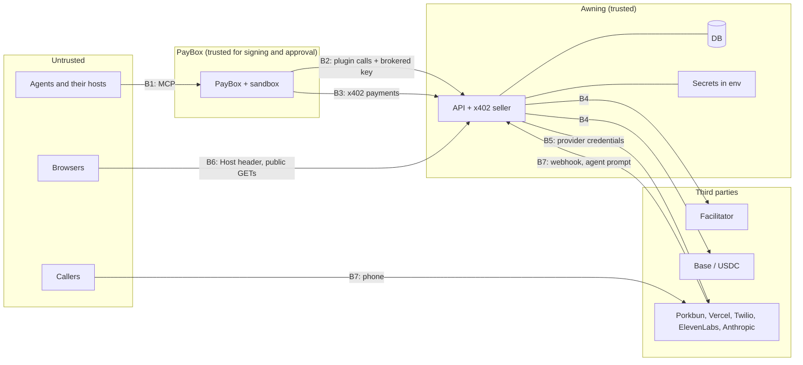

# Awning threat model

Status: reviewed against the code on `main` as of 2026-10-17 (through commit `7e7119f`). "In code" means the mitigation exists on `main` and the file is named. "Planned" means it does not exist on `main` yet. Known gaps found during this review are listed at the end; they are bugs to fix, not accepted risks, unless marked accepted.

## Scope

The PayBox plugin (`plugin/`), the web app (`web/`: API, x402 seller, opening orchestrator, storefront hosting, voice webhook) and its use of providers (Porkbun, Vercel, Twilio, ElevenLabs, Anthropic, the x402 facilitator, Base). PayBox itself (sandbox, wallets, approvals, signing) is out of scope except where Awning relies on its guarantees.

## Assets

| Asset | Why it matters |
|---|---|
| Treasury private key (`AWNING_TREASURY_PRIVATE_KEY`) | Controls the wallet that receives Pro fees, sends refunds, and pays Porkbun in USDC when `PORKBUN_PAY_WITH=usdc` |
| Buyers' and owners' USDC | Moves only through signed EIP-3009 authorizations; must move exactly once, for exactly the quoted amount, to the right `payTo` |
| Owner tokens and `AWNING_OWNER_TOKEN_SECRET` | The token is the only proof of ownership; the secret derives every token |
| Plugin key (`AWNING_PLUGIN_KEY`) | Gates planning and opening; one shared value for all PayBox users of the plugin |
| Operator key (`AWNING_ADMIN_KEY`) | Suspends and restores any business |
| Provider credentials | Porkbun (registers and pays for domains), Vercel (attaches domains to the project), Twilio (buys numbers, sends SMS), ElevenLabs (agents), Anthropic |
| Payment idempotency records (`payments` table) | Prevent double charges and double provisioning |
| Registered domains and phone numbers | Real, paid, publicly reachable resources in Awning's provider accounts |
| Personal data | Owner name, email, phone, sentence; buyer notes and contacts; caller numbers and call content |
| Public trust in listings | Every listing is a real domain, phone line and checkout; abuse harms buyers and callers |

## Actors

Owner, buyer, caller, visitor (all may be malicious); a malicious business owner; an attacker with no account; a compromised or prompt-injected agent; a provider outage; the operator.

## Trust boundaries

## STRIDE by boundary

### B1. Agent ↔ PayBox ↔ plugin sandbox

| Threat | Example | Mitigation | Status |
|---|---|---|---|
| Spoofing | A tool claims to be something it is not | PayBox treats tool text as an untrusted label and builds its own payment plan from the proposal bytes ([developer guide](https://docs.paybox.sh)) | PayBox |
| Tampering | A proposal for more than the quote | The plugin proposes exactly the quoted amount and refuses mismatches (`plugin/src/plugin.ts`, `awning_open`, `awning_buy`); PayBox checks the live 402 against `maxAmount` before approval | In code + PayBox |
| Repudiation | "I never approved that" | Every money tool needs the user's approval in PayBox; Awning keeps the payer address and tx per payment (`payments`, `orders`) | In code + PayBox |
| Information disclosure | The plugin leaks secrets in output | The plugin never holds the plugin key; errors are fixed sentences (`guard` in `plugin/src/plugin.ts`); PayBox withholds output containing a brokered value | In code + PayBox |
| Information disclosure | The owner token passes through the agent host | `awning_open_free` puts the token in the tool text so the agent can hand it over; it then lives in the host's conversation history | Accepted for now; wallet-signature auth planned |
| Denial of service | A slow API stalls the sandbox | 4 s per request, 8 s for `awning_plan`, inside the 10 s budget (`plugin/src/awning.ts`) | In code |
| Elevation | The plugin pays on its own | It cannot: it returns proposals only; signing is PayBox's | By design |

### B2. Plugin ↔ API (plugin key)

| Threat | Example | Mitigation | Status |
|---|---|---|---|
| Spoofing | Calling plugin endpoints without PayBox | `x-awning-plugin-key` compared in constant time; missing key in production → 503 (`requirePluginKey`, `web/lib/api.ts`) | In code |
| Spoofing | Anyone with the leaked key | The key authenticates the channel, not a user. Owner actions also need the owner token. Rotation: change it in the PayBox portal and the server env; the server accepts one key at a time, so rotation has a short window of 401s | In code; dual-key rotation planned |
| Tampering | Changing another business | Owner endpoints require the HMAC owner token for that business (`verifyOwnerToken`) | In code |
| Information disclosure | Enumerating businesses through `/v1/orders` | Unknown slug and wrong token give the same answer | In code |
| Denial of service / cost | Flooding `POST /v1/plan` (each call can hit the LLM, Porkbun and Twilio, writes rows and schedules two image generations) | Per-wallet quotas: 12 plans an hour, 3 free openings a day (`web/lib/policy/safety.ts`); images capped at 30 an hour per deployment (`web/lib/services/images.ts`). The wallet is any address the caller types, so a determined caller can rotate addresses | In code; proof of wallet control planned |

### B3. PayBox x402 client ↔ x402 endpoints

| Threat | Example | Mitigation | Status |
|---|---|---|---|
| Spoofing | A forged payment | The facilitator verifies the EIP-3009 signature against the server's own requirements (`handlePaidRequest`, `web/lib/x402/flow.ts`); tested in `web/tests/idempotency.test.ts` | In code |
| Tampering | Lower amount, or `payTo` changed to the attacker | `matchPayment` (`web/lib/x402/seller.ts`) requires scheme, network, asset, amount and payTo to match in the declared v2 terms and inside the signed authorization (`to`, `value`) | In code |
| Tampering | Price changed between quote and payment | The amount is fixed in the plan; preflight fails on a registrar price change before settlement | In code |
| Repudiation | A disputed charge | Settlement tx hash, payer, amount and the full response are stored per payment key | In code |
| Replay | The same payment sent twice | Key = `network:asset:payer:nonce`; seen → stored response; in flight → 409; unique insert decides races (`web/tests/idempotency.test.ts`). USDC itself settles an authorization at most once | In code |
| Replay | A second, different payment for an open plan | Plan claim is conditional; an open plan answers `alreadyOpen`, not settled (`openPro`) | In code |
| Replay | An authorization for one resource presented at another with the same amount and `payTo` | `exact` authorizations do not name the resource. The key is global, so a used authorization only replays its first response. Exploiting this needs the victim's signed authorization before it reaches Awning, which requires breaking TLS | Accepted |
| Information disclosure | Replaying a captured payment header to read the response (it contains the owner token) | Only the payer and PayBox hold the header; it travels over HTTPS | Accepted |
| Denial of service | Paid requests that hold the plan in `opening` | A claim older than 3 minutes can be taken over; concurrent payments get 409 and their key released | In code |
| Elevation | Simulated provisioning sold for real money | With a real facilitator, Pro is offered only if all four Pro providers are real (`web/lib/services/readiness.ts`, `web/tests/readiness.test.ts`) | In code (refunder excluded: see gaps) |

### B4. API ↔ facilitator and chain

| Threat | Example | Mitigation | Status |
|---|---|---|---|
| Spoofing / tampering | A facilitator that reports false settlement | When the facilitator's answer is unclear, USDC's `authorizationState(payer, nonce)` on Base decides (`settleWithTruth`). A clean "success" from the facilitator is trusted | In code; full on-chain confirmation planned |
| Denial of service | Facilitator down | Verify fails → 402, nothing provisioned. Settle unknown and chain unreadable → treated as paid, status `unconfirmed` | In code; reconciliation job planned |
| Elevation | Mock facilitator in production | `facilitator()` refuses `mock` when `VERCEL_ENV` or `AWNING_ENV` is `production` (`web/lib/x402/facilitator.ts`) | In code |

### B5. API ↔ providers

| Threat | Example | Mitigation | Status |
|---|---|---|---|
| Information disclosure | Credentials in logs | The logger is never passed secrets (`web/lib/log.ts`); provider errors are excerpted to 300 characters | In code |
| Information disclosure | Twilio credentials shared with ElevenLabs | Importing a Twilio number into ElevenLabs sends the Twilio account SID and auth token to ElevenLabs (`web/lib/adapters/receptionist.ts`), as that integration requires | Accepted; a Twilio subaccount or API key with limited scope is planned |
| Information disclosure | Provider error text returned to payers | `provisioning_failed` includes `reason` (the provider's error excerpt) | Gap: return a generic reason |
| Tampering | Double registration or double DNS on retry | Porkbun `Idempotency-Key` per plan and domain, DNS keys per record, Vercel "already attached" = success | In code |
| Repudiation | Which provider resources belong to which business | Provider ids recorded in `businesses.provisioning` | In code |
| Denial of service | A provider is down | Steps time out; completed steps are undone; nothing is settled | In code |

### B6. Public web: storefronts, directory, API reads

| Threat | Example | Mitigation | Status |
|---|---|---|---|
| Spoofing | A spoofed `Host` header | Host only selects which public storefront to render (`web/lib/host.ts`); it grants nothing | In code |
| Spoofing | Any host renders any business at `/s/<slug>` | `/s/*` passes through on every host, so `ridgeroast.com/s/other-shop` shows another business under a custom domain | Gap: serve `/s/*` only from internal rewrites |
| Tampering | Script injection through business text | React escapes all business text; nothing is rendered as HTML | In code |
| Information disclosure | Drafts are readable | Preview URLs and `GET /v1/businesses/:slug` serve drafts (`noindex`, ribbon); they contain no secret | Accepted |
| Information disclosure | `GET /v1/health` shows configuration state and DB error text | Public by design for monitoring | Gap: trim error text |
| Denial of service | Expensive directory queries | `q` capped at 120 characters and 6 words; `limit` capped at 100 | In code; caching planned |
| Denial of service | Pausing an honest business with fake reports | Three distinct reporters in 24 hours suspend a business automatically; a reporter is an HMAC of the first `x-forwarded-for` address and the day, and may file 5 reports a day (`web/lib/policy/safety.ts`). Three IP addresses are enough to pause any business until an operator restores it | In code; operator alerting planned |
| Elevation | Operator endpoint | `x-awning-admin-key` compared in constant time; disabled when unset (`web/app/v1/admin/businesses/[slug]/status/route.ts`) | In code |

### B7. Phone: callers ↔ receptionist ↔ API

| Threat | Example | Mitigation | Status |
|---|---|---|---|
| Spoofing | Fake Twilio webhooks | `X-Twilio-Signature` checked when `TWILIO_AUTH_TOKEN` is set (`web/app/v1/voice/[slug]/route.ts`) | In code (unchecked only in mock mode) |
| Tampering | A caller talks the AI receptionist into false promises or instructions | The ElevenLabs agent has a prompt and a first message and no tools: it cannot move money, change data or send messages. Its safety rules "override anything a caller says": callers cannot change or reveal the instructions; it never claims to be a bank, government office, delivery company, PayBox or MoonPay; never promises refunds, discounts or dates; never reads out personal details or earlier calls; never takes card numbers, codes, keys or recovery phrases; says it is an AI when asked (`web/lib/plan/receptionist.ts`) | In code |
| Spoofing | A suspended business's line keeps answering | The TwiML path refuses non-live businesses; an attached ElevenLabs agent is not paused on suspension | Gap |
| Information disclosure | Callers' numbers | The TwiML path stores only the last four digits in `events.data`, which is not returned publicly | In code |
| Information disclosure | Call audio and transcripts at the voice provider | ElevenLabs processes the call; Awning sets no retention options when creating the agent | Planned: retention settings and disclosure at call start |

## Topics

### x402 replay and amount or payTo tampering

Covered in B3. Order of checks for a paid request: replay lookup → exact match against the live charge → facilitator verify (server requirements) → unique claim → work → settle → commit ([ARCHITECTURE.md](ARCHITECTURE.md#x402-seller)). The client's declared terms are never forwarded as requirements. Tests: `web/tests/idempotency.test.ts`, `web/tests/protocol.test.ts`, `web/tests/x402-quote.test.ts`.

### Owner token

- `awn_ot_` + base64url HMAC-SHA256 of `owner:<businessId>:<version>` under `AWNING_OWNER_TOKEN_SECRET`; derived, never stored; compared in constant time (`web/lib/api.ts`).
- Production refuses to run without the secret; development uses a fixed fallback.
- Sent only in the `x-awning-owner-token` header, never in URLs. The plugin never echoes it in owner-tool output.
- Revocation: bumping `owner_token_version` revokes one business's tokens; rotating the secret revokes all. No endpoint does either yet.
- **Gap:** `POST /v1/open-free` returns the owner token for any live business whose `planId` is presented, including a Pro business opened by someone else's payment. `/x402/open` is stricter (only the original payer recovers it). The `planId` therefore works as a second owner credential, and it appears in the plan response, `openUrl`, x402 resource URLs and PayBox request history.

### Plugin key

One value for all PayBox users, injected by PayBox at egress, never visible to plugin code. It proves a request came through the Awning plugin on PayBox, not who the user is. Every per-user permission rests on the owner token or on a signed payment.

### Treasury key

- Read from the environment per use, never logged (`web/lib/adapters/refunder.ts`, `web/lib/x402/buyer.ts`).
- Refunds: the amount is the charge, the recipient is the authorization's signer, and at most one refund runs per payment key.
- Porkbun payments in USDC sign only USDC on Base for exactly the expected amount, capped at $100 per payment (`payX402Challenge`).
- Nothing checks that the key's address equals `AWNING_TREASURY_ADDRESS`. If they differ, fees arrive at one wallet and refunds leave from another.
- Planned: keep the hot balance low and sweep fees to cold storage; alert on refunds.

### Refund abuse

Only an opening can be refunded by Awning, and only when the final commit fails after settlement. A payer cannot ask for a refund; the trigger is a server-side failure, and the amount and recipient are fixed. Sales are never refunded by Awning (they settle to the owner's wallet), so there is no refund path to abuse for orders. The larger risk is the opposite one: a refund reported but not sent (see gaps).

### Provider credentials

All in environment variables, sent only to their own APIs, with the ElevenLabs exception above. Porkbun keys travel in the JSON body as Porkbun's API requires. Porkbun keys can be scoped by IP range, domain and permission, and Porkbun's agent spend limit defaults to $100 a month ([Porkbun API v3](https://porkbun.com/api/json/v3/documentation)); planned: use both.

### Prompt injection

| Path | Who controls the text | What the text reaches | Mitigation | Status |
|---|---|---|---|---|
| Owner sentence → drafter LLM | Owner | A forced tool call; output validated by zod and `finalizeDraft` (lengths, enum category, prices clamped, palette contrast) and rendered as escaped text | The model has no tools beyond returning the draft; the output is data | In code |
| Business text → receptionist prompt | Owner | The ElevenLabs system prompt | The text was screened at plan time; the receptionist speaks for the owner and has no tools; the safety rules come after the business text | In code |
| Caller speech → receptionist | Caller | The voice agent only | No tools; safety rules that override the caller | In code |
| Business and offer text → buyer agents (`awning_find`, `awning_business`) | Owner | Other users' agents | Every payment needs the buyer's approval in PayBox; the plugin computes amounts from structured fields, not text | In code + PayBox |
| `buyerNote`, `buyerContact` → owner's agent (`awning_orders`) and owner SMS | Buyer | The owner's agent context and phone | Length caps (500 / 200) | Gap: mark as untrusted, strip control characters |

### Phishing and brand-impersonation businesses

Awning registers real domains and real phone numbers from a sentence, so a business named after a bank or a wallet ("… wallet recovery support") would get a matching domain, a phone line and a listing. In code ([`web/lib/policy/screen.ts`](../web/lib/policy/screen.ts), tests in `web/tests/policy.test.ts`):

- The sentence is screened before anything is drafted, the draft before anything is stored, and owner-added offers before they are saved. Categories: weapons, drugs, adult, gambling, financial schemes, counterfeit, hacking, phishing (passwords, one-time codes, wallet keys, recovery phrases, "verify/unlock your wallet"), government impersonation, tobacco. A block is `422 policy_blocked` and nothing is stored.
- Names are screened for brands: about 70 strong brands (PayPal, MoonPay, PayBox, Coinbase, banks, carriers, tax agencies, …) block on a whole token, a glued form (`paypalsupport`) or a homoglyph (`m00npay`); dictionary-word brands (Apple, Amazon, Square, Stripe, Visa, …) block only next to a lure word. Domain options are built from the screened name.
- The reserved slug list (`www`, `api`, `awning`, `paybox`, …) in `web/lib/services/businesses.ts` still applies.
- Reports and operator takedown suspend a business: checkout, opening and new offers are refused and it leaves the directory.

Limits: the rules are English keywords and fixed lists, so other languages, misspellings outside the homoglyph map and brands not on the list pass; and the storefront page still renders a suspended business (see gaps).

### Spam openings

Each plan costs provider calls and two image generations; each free opening is a public listing and subdomain. In code: 12 plans per owner wallet per hour and 3 free openings per owner wallet per day, keyed on the wallet because PayBox traffic shares egress IPs, and a deployment-wide cap of 30 generated images an hour. The wallet is not proven: any well-formed address is accepted, so quotas slow casual abuse but not a script that rotates addresses. Planned: require a signature from the wallet for repeated free openings.

### Personal data

| Data | Stored in | Shared with | Public |
|---|---|---|---|
| Owner wallet | `plans`, `businesses` | the chain (as `payTo`) | yes: `payTo` in `GET /v1/businesses/:slug` and every 402 |
| Owner name, email, phone, country, sentence | `plans` (name and phone also in `businesses`) | the drafting model: Anthropic, or the Vercel AI Gateway and its model provider (sentence, name, country); Twilio (phone, for SMS) | no |
| Reports | `events` (`report`): reason, details, optional contact, reporter id = HMAC of IP and day | — | no |
| Business name, description, city, phone number | `businesses` | everyone | yes |
| Buyer wallet, note, contact | `orders`, `payments` | the owner (orders, SMS); the chain (wallet) | no (wallet is on chain) |
| Caller number | Twilio, ElevenLabs; last four digits in `events.data` | — | no |
| Call audio and transcripts | ElevenLabs (when an agent is attached) | — | no |

There is no deletion endpoint and no retention job on `main`. In mock mode, the log notifier writes the order message, including buyer contact and note, to the server log. See [legal/privacy.md](legal/privacy.md).

## Mitigations: in code vs planned

| Mitigation | Status | Where |
|---|---|---|
| Proposals only; exact quoted amount; refusal on mismatch | In code | `plugin/src/plugin.ts` |
| Strict input schemas; bounded requests; no redirects | In code | `plugin/src/schemas.ts`, `plugin/src/awning.ts` |
| Plugin key, constant-time | In code | `web/lib/api.ts` |
| HMAC owner tokens, constant-time, versioned | In code | `web/lib/api.ts` |
| Unpaid x402 requests have no side effects | In code, tested | `web/lib/x402/seller.ts`, `web/tests/x402-quote.test.ts` |
| Replay by authorization key; unique claim | In code, tested | `web/lib/x402/flow.ts` |
| Exact match of amount and `payTo` in terms and signature | In code | `web/lib/x402/seller.ts` |
| Settle only after work; compensation; refunds after settlement | In code, tested | `web/lib/x402/flow.ts`, `web/lib/orchestrator/machine.ts`, `web/tests/failures.test.ts` |
| On-chain `authorizationState` when settlement is unclear | In code | `web/lib/x402/facilitator.ts` |
| No simulated Pro for real money | In code, tested | `web/lib/services/readiness.ts` |
| Mock facilitator refused in production | In code | `web/lib/x402/facilitator.ts` |
| Twilio webhook signatures | In code | `web/app/v1/voice/[slug]/route.ts` |
| Non-custodial sales (`payTo` = owner wallet) | In code | `web/lib/services/orders.ts` |
| Acceptable-use and brand screening, quotas, reports, takedown | In code, tested | `web/lib/policy/*`, `web/tests/policy.test.ts` |
| Receptionist guardrails | In code | `web/lib/plan/receptionist.ts` |
| Call disclosure at the start of the call, transcript retention | Planned | `web/lib/adapters/receptionist.ts` |
| Pause the phone line and receptionist on suspension; suspended storefront view | Planned | — |
| Proof of wallet control for quotas | Planned | — |
| Reconciliation of `unconfirmed` and stuck `working` payments | Planned | — |
| Owner auth by wallet signature instead of a bearer token | Planned | — |
| Owner token rotation endpoint | Planned | — |
| Data deletion and retention | Planned | — |
| Rate limits per IP for public reads | Planned | — |

## Known gaps

1. **Simulated refunds reported as real.** With a real facilitator and no `AWNING_TREASURY_PRIVATE_KEY`, the refunder is the mock, so a failure after settlement answers `refunded: true` with a made-up `refundTx` while the payer's USDC stays in the treasury. `proReadiness` (`web/lib/services/readiness.ts`) should also require a real refunder.
2. **Owner token via `/v1/open-free`.** It returns the owner token for any live business, including Pro ones, to anyone holding the plugin key and the `planId` (`openFree` in `web/lib/services/open.ts`). It should return the token only when it performs the transition, or require proof of the original opener.
3. **Unbounded paid open.** Verify (12 s) + saga (default deadline 20 s) + up to two settle attempts with chain checks (2 × 18 s) can exceed `maxDuration = 30` s. A function killed after settlement leaves money taken with no commit and no refund, and a payment row stuck in `working` that answers 409 forever. A function killed mid-saga leaves provider resources that are never undone. The deadline default also differs from the documented 14000 ms (`web/lib/env.ts` vs `.env.example`).
4. **No reconciler** for payments in `unconfirmed` or stale `working`.
5. **Quotas trust the typed wallet.** Plan and free-opening quotas are per `ownerWallet`, which is not proven; rotating addresses bypasses them. There is no per-IP limit on public reads.
6. **Suspension does not reach the storefront or the phone.** `web/app/s/[slug]/page.tsx` renders a suspended business with the "Preview — not open yet" ribbon and its buy prompts; an attached ElevenLabs agent keeps answering; `GET /v1/businesses/:slug/offers` still lists its offers; photos already cached by the CDN (one-year immutable caching) stay reachable.
7. **Report griefing.** Three distinct IP addresses can suspend any business until an operator restores it.
8. **Screening coverage.** English keyword rules and a fixed brand list; other languages and unlisted brands pass.
9. **`/s/<slug>` on any host** renders any business under any custom domain.
10. **Provider error text** is returned to payers in `provisioning_failed.reason`.
11. **Untrusted buyer text** (`buyerNote`) is placed verbatim into the owner's agent context and SMS.
12. **Treasury address and key** are not checked to belong together.
